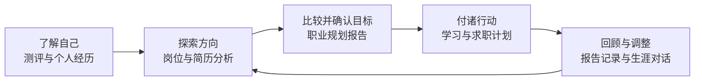
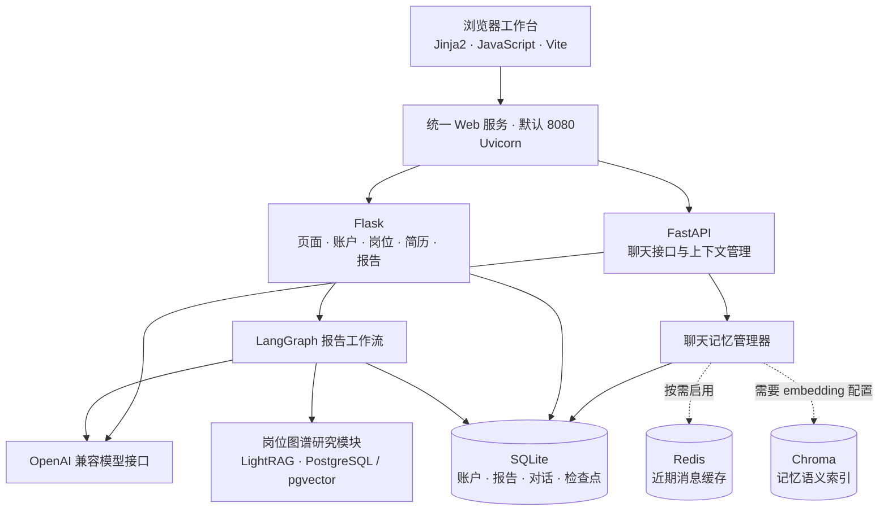
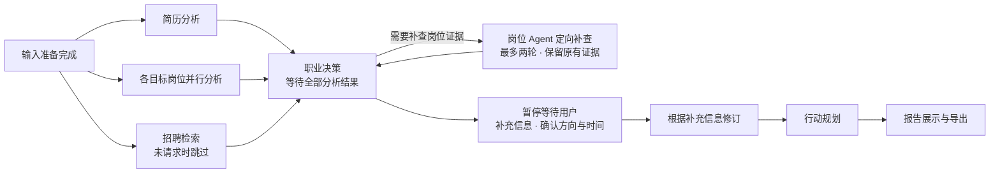

<div align="center">

# 🧭 智航生涯 · Career Planning

**从认识自己，到选择方向，再到落实下一步行动。**

职业测评 · 岗位探索 · 简历分析 · AI 规划报告 · 生涯对话

[功能一览](#features) · [快速启动](#quickstart) · [系统架构](#architecture) · [配置服务](#configuration) · [项目目录](#development)

[](requirements.txt)
[](package.json)
[](requirements.txt)
[](backend/services/chat/api.py)

[](frontend/vite.config.mjs)
[](backend/advisor/report_workflow.py)
[](https://github.com/hankwang712/Career-Planning/stargazers)

</div>


智航生涯是一个职业探索与求职准备工作台，结合个人经历、测评结果和岗位数据，帮助用户比较职业方向、生成规划报告并制定行动计划。

<a id="features"></a>

## ✨ 功能一览

| 模块 | 可以做什么 |
| --- | --- |
| 🧩 测评中心 | MBTI、霍兰德、深层 MBTI、老友记角色、情绪主导、SBTI 六项测评；保存答题进度、查看历史结果，基础测评支持最近两次结果对比。 |
| 🔎 岗位探索 | 定时获取公开招聘岗位，查看最新机会、样本行情、技能要求与来源时间，支持多维筛选和 Excel 导出；保留历史岗位档案与城市分析。 |
| 📄 简历分析 | 上传 PDF、DOCX 等简历，诊断经历深度、表达问题与证据缺口，给出有原文依据的修改建议；扫描文档可通过 OCR 读取。 |
| 🗺️ 职业规划报告 | 结合简历、目标和偏好分阶段生成报告，支持补充信息、确认方向、编辑润色、版本查看与 Word / PDF 导出。 |
| ✅ 行动与学习计划 | 根据阶段、目标和可投入时间安排近期任务，延伸到中长期成长路线；为准备事项提供交付成果与验收标准。 |
| 💬 AI 生涯助手 | 围绕职业选择、简历、面试和学习规划持续对话，结合工作台资料、简历与已保存记忆回答，支持图片输入。 |
| 📰 资讯与社区 | 查看职业资讯、相关新闻，发布求职经验、岗位讨论及回复。 |
| 👤 个人与管理中心 | 统一维护职业画像、技能证据、职业目标、测评和简历版本，追溯资料来源与修改历史；管理员管理账户及模型接口。 |



## 🖼️ 主要功能界面

截图更新于 **2026-11-06**，个人资料使用匿名演示数据。

| 实时岗位与行情 | 城市招聘分析 |
| :---: | :---: |
| [](asserts/jobs.png) | [](asserts/city-analysis.png) |

| 统一职业档案 | 技能与证据 |
| :---: | :---: |
| [](asserts/career-profile.png) | [](asserts/skill-evidence.png) |

| 六项职业与人格测评 | 简历材料与报告生成台 |
| :---: | :---: |
| [](asserts/assessments.png) | [](asserts/resume-analysis.png) |

| 职业规划报告 | 学习路径与任务板 |
| :---: | :---: |
| [](asserts/career-report.png) | [](asserts/learning.png) |

| AI 生涯助手 | Offer 茶水间 |
| :---: | :---: |
| [](asserts/assistant.png) | [](asserts/community.png) |

<details>
<summary>📰 查看行业资讯与多智能体协作流程</summary>

**职业与行业快报**：按主题浏览技术、就业与职业成长资讯，保留来源和发布时间。

[](asserts/career-news.png)

**报告协作流程**：从简历分析、岗位证据到目标确认、行动规划与报告合成，页面展示各阶段的执行状态。

[](asserts/agent-workflow.png)

</details>

<details>
<summary>🕸️ 查看 LightRAG 岗位知识图谱</summary>

岗位图谱将角色、技能、任务和能力要求关联起来，支持技能检索和岗位比较。

[](asserts/lightrag-career-graph.png)

图谱演示使用独立的 **200 条 JD** 样本。

</details>

<details>
<summary>🗃️ 查看数据集与规模</summary>

[](asserts/datasets.png)

数据经清洗、去重与统一字段处理后，形成 **81,296 条岗位记录 + 3,600 条分类知识**。以下数量对应当前仓库数据快照：

| 数据分类 | 最终记录数 |
| --- | ---: |
| 城市招聘样本 | 4,037 |
| 补充城市岗位 | 2,685 |
| 公开招聘快照 | 74,574 |
| 职业分类知识 | 1,827 |
| 行业分类知识 | 1,773 |

数据位于 `data/cleaned/merged/`，保留来源记录。招聘快照不代表岗位仍在招聘。

</details>

<a id="quickstart"></a>

## 🚀 快速启动

推荐 **Python 3.12 + Node.js 22**。以下命令均在项目根目录执行。

### 1. 安装依赖

**Windows PowerShell**

```powershell
python -m venv .venv
.\.venv\Scripts\Activate.ps1
python -m pip install -r requirements.txt
npm ci
```

<details>
<summary>macOS / Linux 命令</summary>

```bash
python3 -m venv .venv
source .venv/bin/activate
python -m pip install -r requirements.txt
npm ci
```

</details>

首次使用时，将 `.env.example` 复制为 `.env`，填写所需配置。

### 2. 构建并启动

```bash
npm run build
npm start
```

打开 **<http://localhost:8080>**。AI 对话、简历分析和报告生成需要配置模型。

### 3. 配置 AI 模型

```bash
python backend/scripts/create_admin.py
```

按提示设置管理员邮箱和密码，登录后在工作台模型设置中填写 **接口地址、API Key、模型名称**，再选择模型。普通账户使用管理员提供的配置。

### 4. 修改前端时启用开发模式

**PowerShell**

```powershell
$env:USE_VITE_DEV_SERVER = "true"
npm start
```

**macOS / Linux**

```bash
USE_VITE_DEV_SERVER=true npm start
```

开发模式同时启动后端和 Vite，仍从 **8080** 访问系统。

<a id="architecture"></a>

## 🏗️ 系统架构与技术组成



### 🗺️ 报告如何生成



简历、目标岗位和招聘雷达并行分析，结果汇总后进入职业决策与行动规划。工作流保存检查点，支持失败重试、用户补充信息后继续执行。

招聘雷达合并 Radar 公开招聘汇总与 JobHunter 本地岗位库，按公司、岗位、城市、招聘批次和职位 ID 去重后筛选，再读取招聘链接核对内容。合并保留各来源及日期，不修改原始岗位库；岗位采集时间不代表公告发布日期或仍开放。JobHunter 尚未采集或岗位库暂不可用时，会说明缺项并继续使用 Radar。独立测试台启动命令：`python backend/tools/recruitment_lab/app.py`，访问 <http://127.0.0.1:8766/>；数据工作台位于 `/radar`，可手动同步、筛选及导入岗位。模型与可选正文提取服务使用根目录 `.env` 配置。

<a id="configuration"></a>

## ⚙️ 模型与可选服务配置

### 模型配置入口

| 配置 | 何时需要 | 配置方式 |
| --- | --- | --- |
| 主站对话模型 | AI 分析、对话与报告 | 管理员工作台模型设置。 |
| 聊天备用模型 | 没有主站模型配置时供聊天使用 | `AI_CHAT_BASE_URL`、`AI_CHAT_API_KEY`、`AI_CHAT_MODEL`。 |
| 聊天 embedding 模型 | 启用记忆语义检索 | `AI_EMBEDDING_BASE_URL`、`AI_EMBEDDING_API_KEY`、`AI_EMBEDDING_MODEL`。 |
| 文生图模型 | 职业画像海报 | `TEXT_TO_IMAGE_API_KEY`、`TEXT_TO_IMAGE_BASE_URL`、`TEXT_TO_IMAGE_MODEL`；可用 `PROFILE_PORTRAIT_MODEL` 单独指定画像模型。 |
| 新闻 embedding | 新闻语义检索 | 参考 [新闻配置示例](.env.example)。 |

配置统一放在根目录 `.env`，完整示例见 [.env.example](.env.example)。进程环境变量优先于文件配置，主站选定的模型优先于聊天备用模型。

### 按需启用服务

| 服务 | 启用条件 | 说明 |
| --- | --- | --- |
| Redis | 安装 Docker，启动下方 Compose 服务 | 用于近期消息缓存；不可用时，聊天记录仍由 SQLite 保存。 |
| Chroma 记忆索引 | 配置 embedding 接口 | 在后端进程中使用本地持久化索引，无需另启 Chroma 服务；未就绪时回退到已保存记忆和资料。 |
| 岗位图谱 | 本地 LightRAG、PostgreSQL / pgvector、研究配置和岗位材料 | 入口见 `artifacts/research/job_graph.py`；LightRAG 检出目录为 `artifacts/research/LightRAG/`，不随主仓库提供。 |
| OCR | 安装 Tesseract 程序及所需语言数据 | 仅安装 Python 的 `pytesseract` 包不够。 |

**启动数据库服务**：先在 `.env` 填写 `POSTGRES_PASSWORD`，首次运行需创建数据卷。

```bash
docker volume create career-agent-memory_memory-redis
docker volume create research_career_pgdata
docker compose up -d postgres redis
```

只需要聊天缓存时，可用 `docker compose up -d redis`。岗位图谱另需准备修改过的 LightRAG 及其依赖；Docker 不负责启动主站。

<a id="development"></a>

## 📁 项目目录

```text
career-agent/
├── backend/
│   ├── server.py                 # 主站入口、页面路由与业务接口
│   ├── advisor/                  # Agent、提示词、报告工作流与招聘雷达
│   ├── services/                 # 聊天、简历、报告、岗位与资讯服务
│   ├── tools/                    # 招聘测试台与数据工作台
│   └── scripts/                  # 启动、管理员与数据构建脚本
├── frontend/
│   ├── templates/                # 页面与可复用 Jinja2 片段
│   ├── static/                   # 业务脚本、样式、媒体与构建资源
│   ├── src/entries/              # Vite 多页面入口
│   └── src/styles/               # 页面样式入口及静态样式导入
├── artifacts/research/           # 岗位图谱导入、查询与维护
├── data/
│   ├── jobs/                     # 城市岗位数据
│   ├── raw/                      # 原始数据及来源说明
│   ├── cleaned/                  # 清洗后的数据
│   ├── knowledge/                # 职业与行业分类资料
│   ├── onet/                     # O*NET 职业资料
│   ├── public/                   # 测评题库等公开资源
│   └── app_data/                 # 数据库、上传文件、报告及对话
├── asserts/                      # README 页面截图
├── deploy/                       # Nginx 示例与静态导出目录
├── requirements.txt              # Python 依赖
├── .env.example                  # 环境配置模板
└── compose.yml                   # PostgreSQL / pgvector 与 Redis
```

## 回归测试

后端使用已安装项目依赖的 Python 环境运行：`python -m unittest discover -s backend/tests`。
前端先运行 `npm install` 和 `npx playwright install chromium`，再运行 `npm run test:browser --workspace frontend`。
浏览器测试默认不保存截图；需要视觉检查时，可将 `CAREER_TEST_SCREENSHOTS` 设置为本地输出目录（例如 `output/browser-tests`）。

## 致谢

本项目参考并使用了以下开源项目，感谢作者的分享：

- [JobHunter](https://github.com/Bynlk/JobHunter)：招聘信息采集。
- [xiaozhao-radar](https://github.com/jiabaobei/xiaozhao-radar)：校招数据聚合与招聘雷达。
- [LightRAG](https://github.com/HKUDS/LightRAG)：岗位知识图谱与检索。

第三方代码的许可证及版权声明保留在对应目录中。
