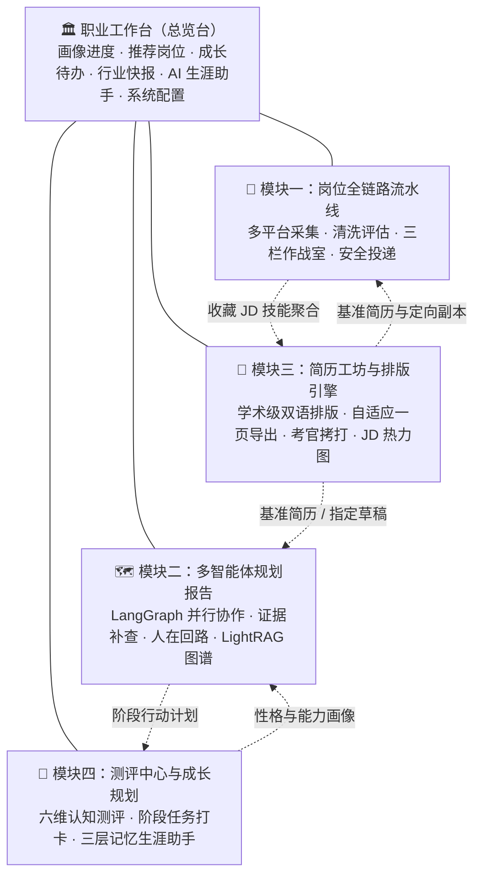
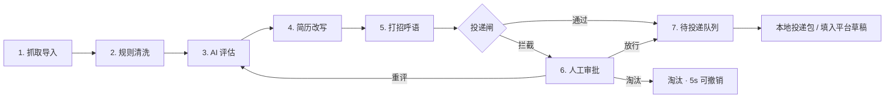
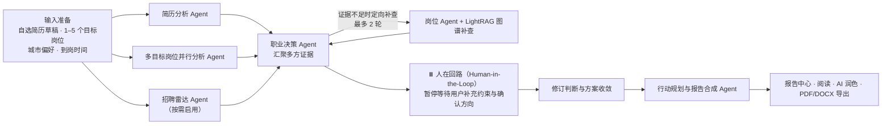
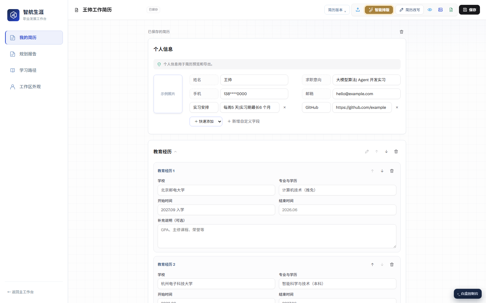
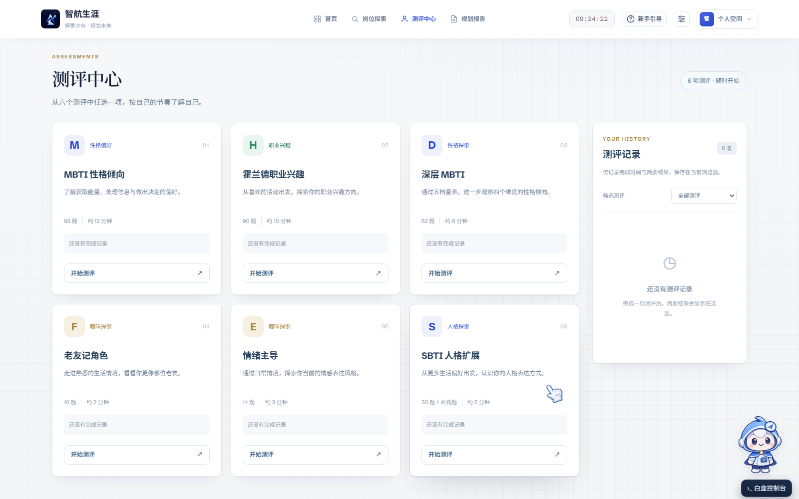
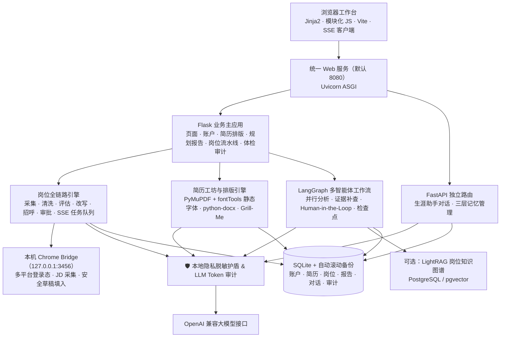

<div align="center">

# 🧭 智航生涯 · Career Planning

**本地优先的 AI 职业规划与全链路求职工作台**

以 **1 个总览工作台** 串联 **4 大核心模块**——从自我认知、多智能体规划、学术级简历打磨到多平台全链路投递，形成完整求职闭环。

[全景总览](#overview) · [岗位流水线](#module-pipeline) · [多智能体报告](#module-report) · [简历工坊](#module-resume) · [测评与成长](#module-growth) · [界面一览](#screens) · [系统架构](#architecture) · [快速启动](#quickstart)

[](requirements.txt)
[](package.json)
[](requirements.txt)
[](backend/services/chat/api.py)
[](backend/advisor/report_workflow.py)
[](frontend/vite.config.mjs)
[](https://github.com/hankwang712/Career-Planning/stargazers)

</div>

<br/>


> **智航生涯**是一套完全运行在本机的个人职业规划与求职执行系统。所有账户、简历、岗位、规划报告与对话记忆均落盘在本地 SQLite，外发大模型前自动经由本地隐私脱敏护盾处理；即使暂未配置大模型，启发式规则也能跑通基础流程。

---

<a id="overview"></a>

## 🏛️ 产品全景：1 个总览台 + 4 大核心模块

过去求职工具往往割裂在「做测评、写简历、看行业、刷岗位」之间。智航生涯以 **职业工作台** 为统一枢纽，让四大模块共享同一份简历、画像与记忆底座：



| 层级 | 定位 | 核心解决什么问题 |
| :--- | :--- | :--- |
| **🏛️ 总览台 · 职业工作台** | 全局中枢与快捷入口 | 聚合画像进度、推荐岗位、待办任务与每日行业快报；提供新手引导、实时终端日志抽屉（`Ctrl+\``）、AI 生涯助手入口与系统配置中心。 |
| **🚀 模块一 · 岗位全链路流水线** | 从找岗到投递的自动化执行 | 把多平台岗位抓取、规则与语义清洗、AI 评估、定向简历/招呼微调、人工审批与安全草稿填入跑成可追踪流水线，并配备单岗位三栏精投作战室。 |
| **🗺️ 模块二 · 多智能体规划报告** | 证据驱动的深度职业决策 | 通过 LangGraph 编排多智能体并行分析简历、目标岗位与招聘雷达，结合 LightRAG 岗位图谱补查证据、人在回路确认后输出结构化决策报告。 |
| **📄 模块三 · 简历工坊与排版引擎** | 高质量简历生产与面试预演 | 表单化多版本管理 + 复刻 XeLaTeX 规范的 PDF/Word 学术排版引擎；内置 AI 考官拷打（Grill-Me）、多岗位 JD 共性热力图与逐条 Diff 改写。 |
| **🧩 模块四 · 测评中心与成长规划** | 认知校准与长期能力沉淀 | 覆盖六项认知/性格测评与结果对比、阶段化学习任务打卡热力图，以及具备三层记忆体系的 AI 生涯对话助手。 |

---

<a id="module-pipeline"></a>

## 🚀 模块一：岗位探索与全链路投递流水线

把公开招聘渠道的岗位机会，跑成一条「可观测、可中止、可回退」的七阶段执行流水线，所有产物落盘 SQLite，实时映射在顶部转化漏斗、7 步执行导航与岗位看板上。



### 七阶段流水线与产物

| 阶段 | 核心能力 | 主要产物 |
| :--- | :--- | :--- |
| **1. 抓取导入** | 通过本机 Chrome Bridge 检查登录态并实时采集 **BOSS 直聘 / 智联招聘 / 前程无忧 / 小红书**，亦支持 CSV 或搜索页导入 | 岗位记录、原站 JD 全文与采集日志 |
| **2. 规则清洗** | 薪资/地点/学历等硬规则 + AI 语义规则双重过滤，支持根据求职意图自动生成清洗规则 | 清洗状态、淘汰理由与待核对标记 |
| **3. AI 评估** | 八维加权初评打分（A–F 评级）；高意向精投岗位继续执行七维深度诊断与风险红旗识别 | 综合得分、评级、亮点与红旗清单 |
| **4. 简历改写** | 以选定的基准简历为底稿，按单岗 JD 关键词定向微调，支持**逐条采纳 / 还原**并另存为简历库副本 | 岗位专属简历稿与行级 Diff |
| **5. 打招呼语** | 基于用户设定的个人打招呼母本做 JD 关键词精准微调（标准 / 精炼 / 项目导向三种风格），保留人感 | 岗位专属招呼语（支持在线修改保存） |
| **6. 人工审批** | 汇总被投递闸拦截或待终审的岗位，在终审台集中查看简历与招呼语，一键放行、重评或淘汰 | 审批决策记录 |
| **7. 投递执行** | 支持生成 JSON / CSV 投递包（dry-run），以及通过 Chrome Bridge 在 **BOSS / 智联 / 前程无忧**自动打开沟通页并**填入草稿（绝不自动发送）** | 投递包、草稿填入记录与失败重试 |

### 核心交互亮点

- **单岗位「三栏精投作战室」**：点击重点岗位进入单页联动视图——**左栏（JD 与深度诊断/红旗/行动清单）｜中栏（专属简历预览与源码微调）｜右栏（打招呼语微调、一键填入平台草稿与岗位专属面试押题）**，告别反复开关抽屉。
- **SSE 真实进度流与可中止调度**：批量清洗、评估、改写、写招呼均通过 SSE 实时推送逐条进度，支持随时中止；切换页面后底部仍保留极简浮动后台任务条。
- **看板批量操作与误操作兜底**：支持表格多选悬浮批量操作栏（批量改写 / 写招呼 / 放行 / 淘汰），淘汰后提供 5 秒撤销 Toast；未配置大模型时自动切换确定性启发式模式跑通全链路。

---

<a id="module-report"></a>

## 🗺️ 模块二：多智能体职业规划报告

面向「方向迷茫、岗位取舍、备考/求职路径规划」场景，基于 **LangGraph** 构建可中断、可补查、可续跑的多智能体协作工作流。



### 核心能力

- **灵活输入与简历自选**：在「本次分析」中可自由下拉选择任意已保存的简历草稿或上传简历，自动带入求职意向，并配合意向城市、办公方式、加班/出差偏好及实习到岗时间发起分析。
- **并行探索 + 证据补查循环**：简历分析、多个目标岗位分析与招聘雷达并行执行；当决策 Agent 发现岗位能力证据不足时，自动触发最多两轮定向补查，并可结合 **LightRAG + PostgreSQL / pgvector 岗位知识图谱** 做跨岗位技能对齐。
- **人在回路与检查点续跑**：决策关键节点主动暂停，以结构化问卷向用户确认真实取舍后再生成行动规划；全流程自动保存 SQLite 检查点，中断或失败后可从断点恢复重试。
- **多版本报告中心**：支持历史版本归档与切换、在线结构化阅读、AI 智能润色，以及 **PDF / DOCX** 一键导出。

<details>
<summary>🕸️ 查看 LightRAG 岗位知识图谱示意</summary>

岗位知识图谱将岗位角色、核心技能、任务场景与能力要求关联起来，支撑技能语义检索与多岗位横向比较（演示图谱基于独立 200 条 JD 样本构建）。

[](asserts/lightrag-career-graph.png)

</details>

---

<a id="module-resume"></a>

## 📄 模块三：简历工坊与学术级排版引擎

简历不仅是静态文档，更是连接规划报告与岗位投递的核心资产。本模块兼顾 **出版级精准排版** 与 **AI 深度打磨**。

### 核心能力

| 维度 | 能力说明 |
| :--- | :--- |
| **多版本表单工坊** | 分模块管理个人信息、教育、工作、项目、专业技能与自定义栏目；支持多份简历副本管理、**40 步全局撤销/重做（`Ctrl+Z / Ctrl+Y`）**、PDF / DOCX / 图片导入与 OCR 识别、证件照裁剪。 |
| **学术级双语排版引擎** | 复刻 XeLaTeX 学术简历版式：西文采用 **Times New Roman**、中文自动从可变字体实例化静态 **Noto Serif SC（Regular / Bold）** 搭配无衬线栏目标题与经典学术蓝（`#004A91`）；内联渲染 GitHub 仓库图标。 |
| **一页自适应与多格式导出** | 内置自适应字号缩放（`font_scale`）智能贴合 A4 单页布局；Word 导出显式锁定表格固定列宽（`w:tblGrid` / `w:tcW`），确保 WPS 与 Microsoft Word 不串行错位；支持 **A4 PDF / Word (.docx) / PNG** 导出。 |
| **AI 考官拷打（Grill-Me）** | 选中简历中的某段核心项目，由 AI 扮演严厉技术面试官连续深挖 3–5 轮（指标口径、边界失败、架构取舍），将回答出的实战干货一键反哺写回简历，同时完成面试预演。 |
| **JD 共性热力图 & Skill 改写** | 聚合已收藏的目标岗位 JD，提炼高频技能分布与基准简历缺口，指导主简历迭代；支持自定义 `SKILL.md` 规范按岗定向改写与逐条 Diff 拼装。 |

---

<a id="module-growth"></a>

## 🧩 模块四：测评中心、成长规划与生涯助手

围绕长期职业发展，打通「自我认知 → 能力补齐 → 随时咨询」的个人成长闭环，并与工作台数据实时联动：

- **🧩 六维认知测评中心**：内置 **MBTI、霍兰德职业兴趣、深层 MBTI、老友记角色、情绪主导、SBTI** 六项测评，自动保存答题断点与历史记录，支持基础测评前后两次结果对比；测评结论自动写入职业画像，供规划报告与 AI 助手引用。
- **📈 阶段化成长规划**：承接规划报告的行动建议，按阶段和目标拆解学习任务，明确交付物、验收标准与进入条件；支持每日打卡、连续天数、经验值与年度热力图追踪。
- **💬 三层记忆 AI 生涯助手**：围绕方向选择、简历打磨、面试复盘与学习计划持续对话。记忆面板清晰区分 **基础资料来源 / 长期稳定记忆 / 本轮会话上下文**，支持无痕对话、图片理解与 Markdown 表格输出。
- **📰 每日行业快报**：在总览工作台按「AI 与前沿、科技行业、就业观察、职业成长」分栏聚合行业动态，保留来源链接与发布时间。

---

## 🛡️ 工程底座与安全保障

在业务功能之外，系统内置了一套面向个人本地使用的工程保障能力：

| 机制 | 设计与实现 |
| :--- | :--- |
| **本地隐私脱敏护盾** | [privacy_shield.py](backend/services/privacy_shield.py)：调用外部大模型执行简历评估、改写、打招呼与考官拷打前，自动将姓名、手机号、邮箱、身份证号替换为占位符，收到回复后在本地无损还原。 |
| **一键环境体检与滚动备份** | [db_backup.py](backend/services/db_backup.py) + [workspace_tools.py](backend/services/workspace_tools.py)：启动时通过 SQLite WAL 安全热备份自动保留最近 5 份数据库快照；系统配置页提供「一键体检」，一次检测对话模型、SQLite 备份、PDF 学术字体引擎、Chrome Bridge、平台登录态与隐私护盾，并附带修复建议。 |
| **LLM Token 与耗时审计** | [llm_audit.py](backend/services/llm_audit.py)：底层统一记录每次模型调用的 `model / prompt_tokens / completion_tokens / latency_ms / 功能模块`，在系统配置页直观展示今日调用量、Token 消耗与平均耗时。 |
| **实时终端日志与后台任务条** | [console_log.py](backend/services/console_log.py) + [pipeline_tasks.py](backend/services/pipeline_tasks.py)：按 `Ctrl+\`` 或 `Ctrl+J` 呼出全局实时日志抽屉；SSE 后台任务跨页面常驻底部胶囊，随时查看或中止。 |

---

<a id="screens"></a>

## 🖼️ 界面一览

截图取自本机个人工作区（敏感信息已脱敏），界面以实际运行版本为准。

| 🏛️ 职业工作台（总览台） | 🚀 岗位全链路流水线 |
| :---: | :---: |
| [](asserts/workspace.png) | [](asserts/pipeline.png) |

| 🗺️ 多智能体规划报告（简历自选） | 📄 简历工坊 |
| :---: | :---: |
| [](asserts/report-wizard.png) | [](asserts/resume-editor.png) |

| 🧩 测评中心 | ⚙️ 系统配置（模型预设 · 体检 · 审计） |
| :---: | :---: |
| [](asserts/assessments.png) | [](asserts/settings.png) |

---

<a id="architecture"></a>

## 🏗️ 系统架构与技术栈



---

<a id="quickstart"></a>

## ⚡ 快速启动

推荐 **Python 3.12 + Node.js 22 + uv**。实时岗位采集需准备本机 Chrome / Edge；启用 LightRAG 岗位知识图谱时另需 Docker Desktop / Docker Engine。

| 工具 | 作用 |
| :--- | :--- |
| `uv` | 管理 Python 3.12、创建 `.venv` 并安装后端依赖 |
| `npm` | 安装前端依赖、构建静态资源并启动统一服务（含 Chrome Bridge） |
| `Docker Compose` | 按需启动 PostgreSQL / pgvector 供岗位图谱使用（主站在宿主机运行） |

### 1. 准备环境并克隆项目

如尚未安装 [uv](https://docs.astral.sh/uv/getting-started/installation/)，按系统执行：

```powershell
# Windows PowerShell
powershell -ExecutionPolicy ByPass -c "irm https://astral.sh/uv/install.ps1 | iex"
```

```bash
# macOS / Linux
curl -LsSf https://astral.sh/uv/install.sh | sh
```

克隆代码并安装依赖：

```bash
git clone https://github.com/hankwang712/Career-Planning.git
cd Career-Planning

uv python install 3.12
uv venv --python 3.12
uv pip install -r requirements.txt
npm ci
```

### 2. 初始化配置

首次运行复制环境模板（已有 `.env` 可跳过）：

```powershell
# Windows PowerShell
Copy-Item .env.example .env
```

```bash
# macOS / Linux
cp .env.example .env
```

主站所有核心功能（工作台、岗位流水线、简历工坊、规划报告、测评与助手）均基于本机 SQLite，无需额外数据库即可直接启动。若需启用 **LightRAG 岗位知识图谱**，在 `.env` 填写 `POSTGRES_PASSWORD` 后启动向量库：

```bash
docker volume create research_career_pgdata
docker compose --profile graph up -d --wait postgres
```

### 3. 构建并启动

```bash
npm run build
npm start
```

浏览器打开 **<http://localhost:8080>** 即可使用。进入顶栏 **「系统配置」** 选择常用模型厂商预设或填写 API 地址 / Key / 模型名，保存后点击 **「一键体检」** 验证模型、字体引擎与本机 Chrome 桥接状态。

> 修改前端源码时，可开启 Vite 热更新模式（仍通过 **8080** 访问）：
> - PowerShell：`$env:USE_VITE_DEV_SERVER = "true"; npm start`
> - macOS / Linux：`USE_VITE_DEV_SERVER=true npm start`

---

<a id="configuration"></a>

## ⚙️ 模型与可选服务配置

网页端「系统配置」保存的设置写入应用数据目录 `model-settings.sqlite3`，保存即生效且优先于 `.env`；密钥默认掩码隐藏。

| 配置项 | 用途 | 入口 / 环境变量 |
| :--- | :--- | :--- |
| **对话模型** | 规划报告、AI 评估/深评、简历改写、考官拷打、打招呼语、生涯助手 | 「系统配置」或 `AI_CHAT_BASE_URL` / `AI_CHAT_API_KEY` / `AI_CHAT_MODEL` |
| **招聘清洗模型** | 岗位语义清洗（未单配时自动复用对话模型） | 「系统配置」或 `CLEANER_LLM_*` |
| **技能向量模型** | 技能对齐、语义检索与行业快报检索 | 「系统配置」或 `AI_EMBEDDING_*` |
| **OCR 服务** | 扫描版简历与图片导入识别（亦可用本机 Tesseract） | 「系统配置」或 `AI_OCR_*` |
| **本机 Chrome 采集** | 复用本机浏览器登录态采集 BOSS / 智联 / 前程无忧 / 小红书与填入草稿 | `CAREER_RECRUITMENT_USE_LOCAL_CHROME=1`（`npm start` 默认自动拉起桥接） |
| **自定义改写 Skill** | 指定简历定向改写规则文件（亦可在简历工坊在线导入） | `RESUME_REWRITE_SKILL_PATH` |

---

## 🧪 开发与测试

```bash
uv pip install pytest                        # 安装测试依赖
uv run --no-project python -m pytest         # 后端全量测试
npm run check                                # 前端静态资源与 TypeScript 检查
npm run test:unit                            # 前端单元测试
npm run test:browser --workspace frontend    # 浏览器端到端测试（需 Playwright Chromium）
```

---

<a id="development"></a>

## 📁 项目目录

```text
career-agent/
├── backend/
│   ├── server.py                    # ASGI 统一入口（Flask + FastAPI + 请求日志）
│   ├── advisor/                     # 多智能体规划报告工作流、协作编排与招聘雷达
│   ├── services/
│   │   ├── recruitment*.py          # 岗位采集、清洗、AI 评估、Chrome 桥接与全链路流水线
│   │   ├── pipeline_tasks.py        # SSE 后台任务调度与中止管理
│   │   ├── resume/                  # 简历工坊、学术 PDF/DOCX 排版引擎、考官拷打与 JD 热力图
│   │   ├── report/                  # 规划报告接口、存储、追踪、导出与润色
│   │   ├── chat/                    # AI 生涯助手接口与三层记忆管理
│   │   ├── job_market/  news/       # 本地岗位库调度与行业快报
│   │   ├── privacy_shield.py        # 发往大模型前的本地 PII 隐私脱敏护盾
│   │   ├── llm_calls.py llm_audit.py# 模型调用重试、JSON 修复与 Token/耗时审计
│   │   ├── db.py db_backup.py       # SQLite 存储与 WAL 安全滚动备份
│   │   ├── workspace_tools.py       # 系统配置、一键环境体检与统计面板
│   │   └── console_log.py           # 实时终端日志缓冲与查询
│   ├── tests/                       # 后端 pytest 自动化测试
│   └── scripts/                     # 一键启动（含 Chrome Bridge）与数据脚本
├── frontend/
│   ├── templates/                   # Jinja2 页面与模块片段（工作台/流水线/报告/简历/设置）
│   ├── static/
│   │   ├── rp/                      # 岗位流水线前端模块化脚本（含三栏精投作战室）
│   │   ├── global-task-bar.js       # 全局浮动后台任务条与实时终端抽屉
│   │   └── *.js / *.css             # 各模块交互脚本与界面样式
│   ├── scripts/                     # 前端静态检查与依赖同步
│   └── tests/                       # 前端单元与浏览器测试
├── artifacts/research/              # LightRAG 岗位知识图谱抽取、导入与查询脚本
├── data/                            # 公开题库、O*NET 资料与本地运行数据（app_data 不入库）
├── asserts/                         # README 界面展示截图
├── requirements.txt                 # Python 依赖清单
├── compose.yml / Dockerfile         # 容器化部署与可选 PostgreSQL / pgvector
└── .env.example                     # 环境变量配置模板
```

---

## 🙏 致谢

本项目在探索与实现过程中参考了以下优秀开源项目，谨致感谢：

- [JobHunter](https://github.com/Bynlk/JobHunter)：招聘信息采集与工作流交互思路参考。
- [Jobhunter AI](https://github.com/jolie-z/jobhunter-ai/tree/main/backend)：招聘平台采集入口、字段规则与工作台设计参考。
- [xiaozhao-radar](https://github.com/jiabaobei/xiaozhao-radar)：校招数据聚合与招聘雷达参考。
- [LightRAG](https://github.com/HKUDS/LightRAG)：岗位知识图谱构建与混合检索。

第三方代码的许可证与版权声明均保留在对应目录中。
