<div align="center">

# 🧭 智航生涯 · Career Planning

**从岗位机会到投递执行，把求职跑成一条可追踪的流水线。**

岗位采集 · 规则清洗 · AI 评估 · 定向改写 · 打招呼 · 投递队列

[岗位流水线](#pipeline) · [功能一览](#features) · [界面一览](#screens) · [快速启动](#quickstart) · [系统架构](#architecture) · [配置服务](#configuration) · [项目目录](#development)

[](requirements.txt)
[](package.json)
[](requirements.txt)
[](backend/services/chat/api.py)

[](frontend/vite.config.mjs)
[](backend/advisor/report_workflow.py)
[](https://github.com/hankwang712/Career-Planning/stargazers)

</div>

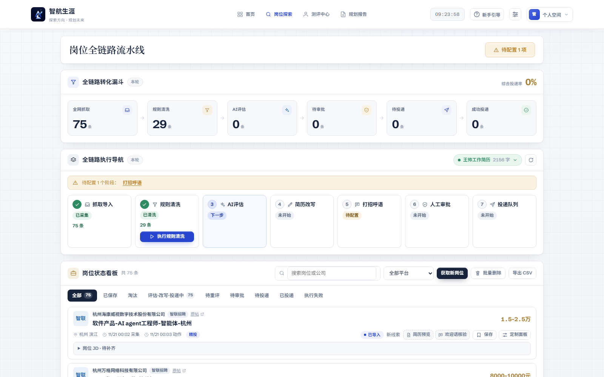

智航生涯是一个在本机运行的个人求职与职业规划工作台。默认进入「岗位探索」，把公开渠道采集到的岗位依次经过规则清洗、八维 AI 评估、定向简历改写、打招呼语和投递队列；模型未配置时，启发式规则也能把全链路跑通。测评、简历、规划报告、学习路径和 AI 生涯助手共用同一套工作区数据。

<a id="pipeline"></a>

## 🚀 岗位全链路流水线

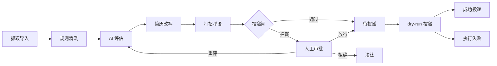

每个阶段都可以单独执行，产物写入本机 SQLite，状态直接反映在漏斗、执行导航和岗位看板上。

| 阶段 | 做什么 | 主要产物 |
| --- | --- | --- |
| 抓取导入 | 从招聘平台实时采集，或导入 CSV / 已保存的搜索页 | 岗位记录与采集记录 |
| 规则清洗 | 硬条件过滤 + 语义规则判定 | 清洗结果、淘汰原因、待核对标记 |
| AI 评估 | 八维加权评级；精投岗位继续深评 | 分数、A–F 评级、深评报告 |
| 简历改写 | 以基准简历为底稿按岗位定向改写 | 定向简历稿 |
| 打招呼语 | 精投生成；海投使用人工母本 | 150–250 字招呼语 |
| 人工审批 | 处理被投递闸拦截的岗位 | 放行 / 拒绝 / 重评 |
| 投递队列 | 本地 dry-run，生成投递包 | 投递记录、JSON / CSV 投递包 |

模型不是流水线的必要条件：未配置对话模型时，清洗、评估、改写、打招呼和投递都能用确定性的启发式规则完成；配置后可在各抽屉中切换为模型模式。

<a id="features"></a>

## ✨ 功能一览

| 模块 | 可以做什么 |
| --- | --- |
| 🚀 岗位全链路流水线 | 从四个招聘平台实时采集岗位，经硬规则与 AI 语义清洗、八维评级、定向简历改写、打招呼和人工审批后进入 dry-run 投递队列；支持保存、批量删除、CSV 导出和每日清理。 |
| 🧩 测评中心 | MBTI、霍兰德、深层 MBTI、老友记角色、情绪主导、SBTI 六项测评。保存答题进度与完成记录，基础测评支持最近两次结果对比；记录保存在当前浏览器。 |
| 🗺️ 规划报告 | 设定最多五个目标岗位、求职偏好和时间安排，并行调用简历分析、岗位分析与招聘雷达；按需补充信息、确认方向后生成报告。支持历史版本、报告阅读、PDF / DOCX 导出与 AI 智能润色。 |
| 📈 成长规划 | 按阶段和目标管理学习任务，提供交付物、验收标准与进入条件；支持今日打卡、连续天数、经验值和热力图。 |
| 📄 我的简历 | 表单化编辑个人信息、教育、工作、项目、技能与自定义栏目；支持多份简历、版本保存、PDF / DOCX / 图片导入与 OCR、照片裁剪、智能排版、A4 PDF / PNG 导出和岗位定向改写。 |
| 💬 AI 生涯助手 | 围绕职业方向、简历、面试和学习计划持续对话。记忆面板区分资料来源、长期记忆与本轮上下文；支持无痕对话、图片输入和 Markdown 表格。 |
| 📰 行业快报 | 按「AI 与前沿、科技行业、就业观察、职业成长」浏览每日资讯，保留来源与发布时间。 |
| ⚙️ 系统配置 | 分组管理对话模型、招聘清洗模型、技能向量模型和部署环境；支持连通性测试、进度总览与单个密钥查看。 |

首页（职业工作台）汇总画像进度、推荐岗位、待完成任务和四类求职工具，并提供行业快报、新手引导和请求控制台。

<a id="screens"></a>

## 🖼️ 界面一览

截图取自本机个人工作区，联系方式已脱敏；界面以实际运行版本为准。

| 全链路看板 | 平台采集 |
| :---: | :---: |
| [](asserts/pipeline.png) | [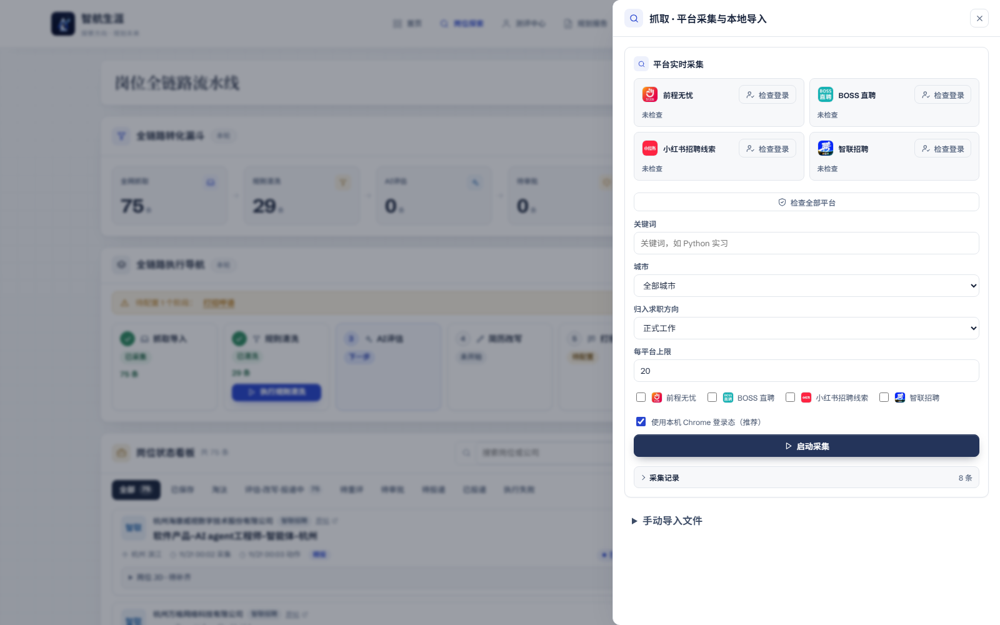](asserts/pipeline-collect.png) |

| 规则清洗 | AI 评估 |
| :---: | :---: |
| [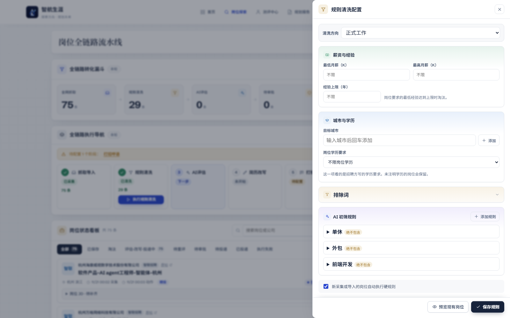](asserts/pipeline-cleaning.png) | [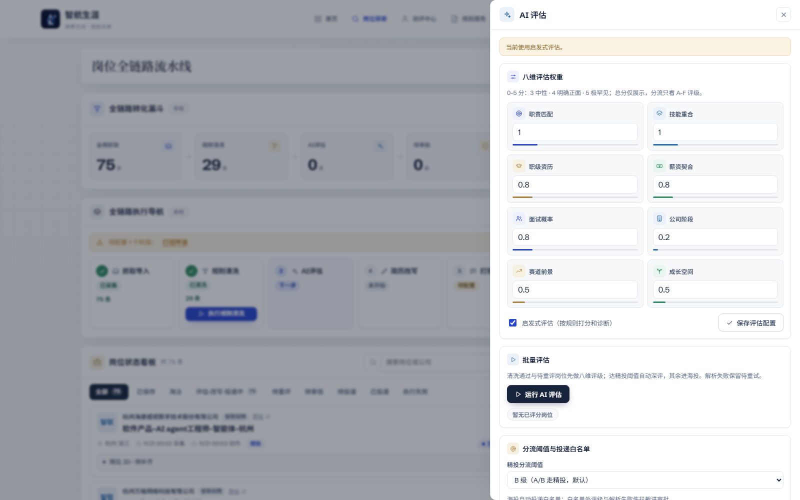](asserts/pipeline-evaluation.png) |

| 定向简历改写 | 打招呼语 |
| :---: | :---: |
| [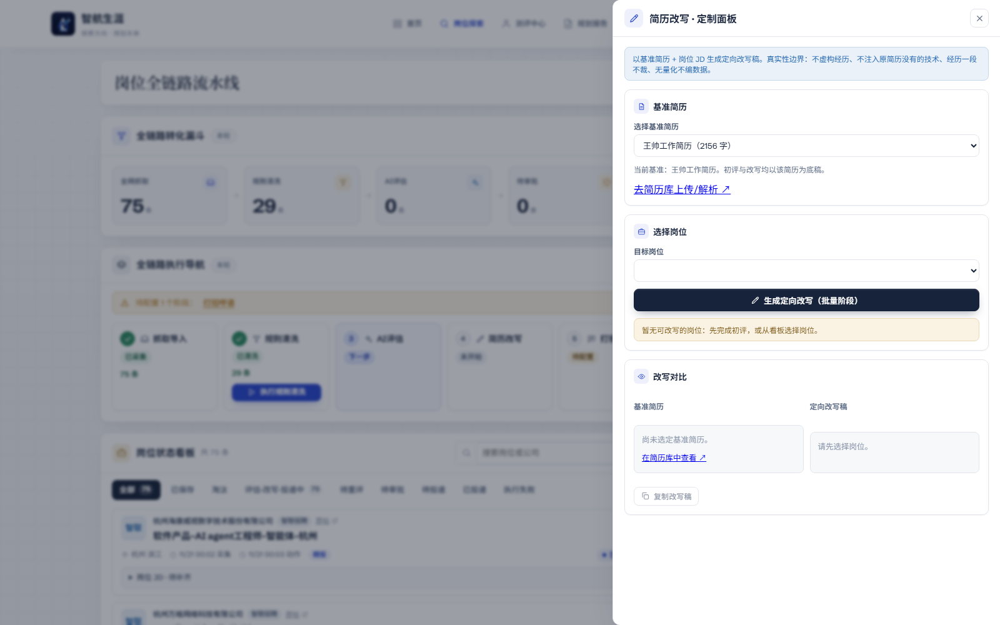](asserts/pipeline-rewrite.png) | [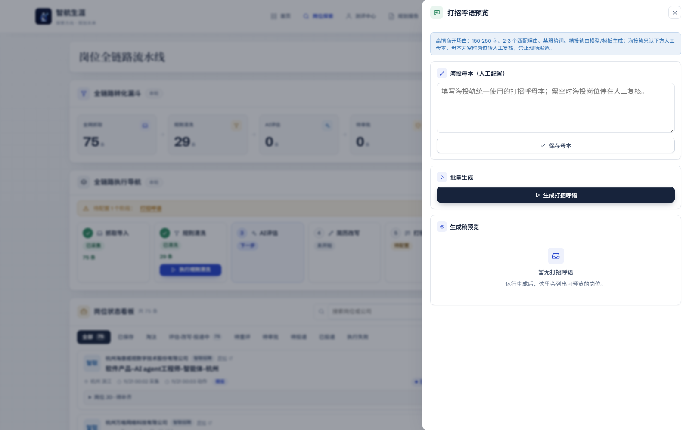](asserts/pipeline-greeting.png) |

| 人工审批 | 投递队列 |
| :---: | :---: |
| [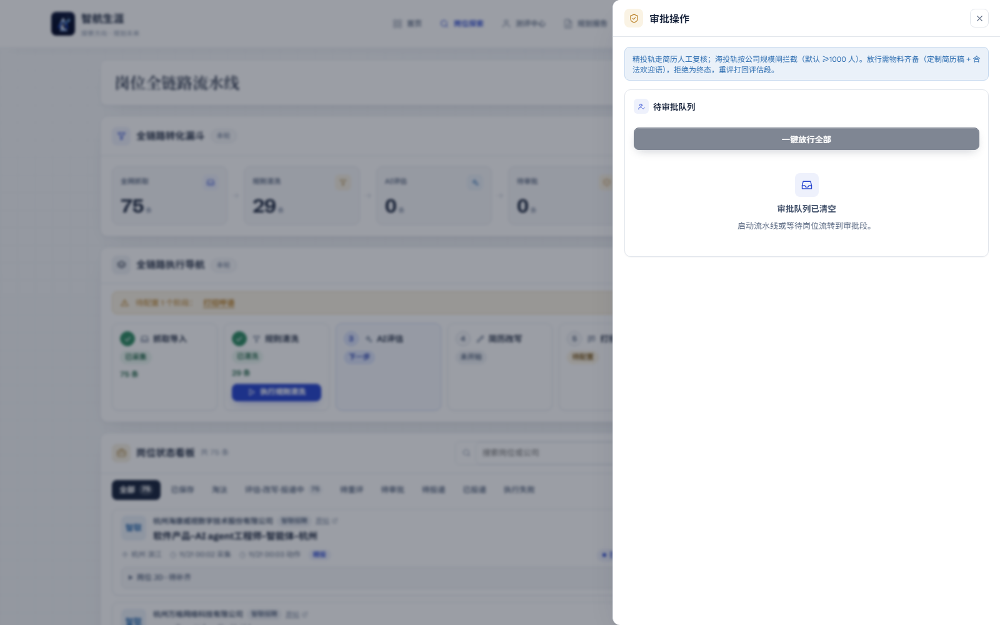](asserts/pipeline-approval.png) | [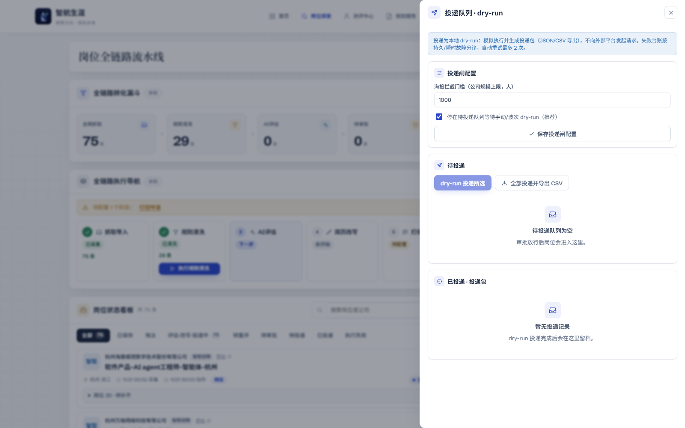](asserts/pipeline-delivery.png) |

| 职业工作台 | 测评中心 |
| :---: | :---: |
| [](asserts/workspace.png) | [](asserts/assessments.png) |

| 规划报告 | 报告中心 |
| :---: | :---: |
| [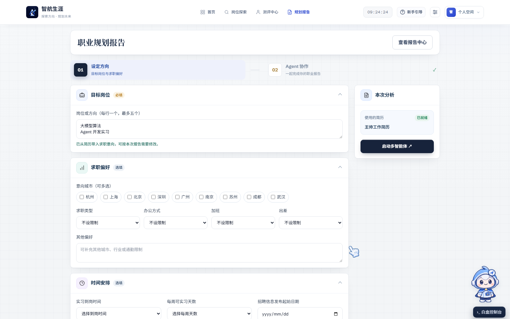](asserts/report-wizard.png) | [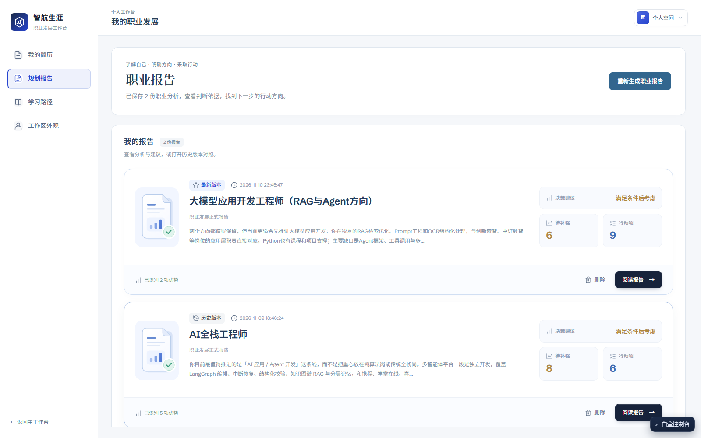](asserts/report-center.png) |

| 我的简历 | 成长规划 |
| :---: | :---: |
| [](asserts/resume-editor.png) | [](asserts/learning.png) |

| AI 生涯助手 | 系统配置 |
| :---: | :---: |
| [](asserts/assistant.png) | [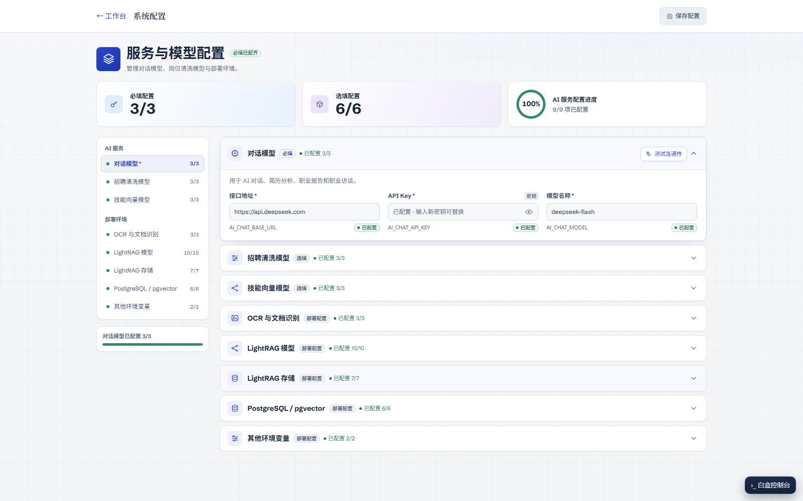](asserts/settings.png) |

<details>
<summary>🕸️ 查看 LightRAG 岗位知识图谱</summary>

岗位图谱将角色、技能、任务和能力要求关联起来，支持技能检索和岗位比较。

[](asserts/lightrag-career-graph.png)

图谱演示使用独立的 **200 条 JD** 样本。

</details>

<a id="quickstart"></a>

## 🚀 快速启动

推荐 **Python 3.12 + Node.js 22 + uv**。需要实时采集时，准备本机 Chrome / Edge 或 Playwright Chromium；需要 LightRAG 图谱时，再安装 Docker Desktop（Windows / macOS）或 Docker Engine + Compose 插件（Linux）。以下命令均在项目根目录执行。

| 工具 | 负责什么 |
| --- | --- |
| uv | 安装 Python、创建 `.venv`、安装 Python 库。 |
| npm | 安装前端依赖、构建页面、启动主站。 |
| Docker Compose | 创建 PostgreSQL / pgvector 服务及持久化环境。主站在宿主机运行。 |

### 1. 安装 uv 并获取项目

安装 [uv](https://docs.astral.sh/uv/getting-started/installation/)（已安装可跳过）：

**Windows PowerShell**

```powershell
powershell -ExecutionPolicy ByPass -c "irm https://astral.sh/uv/install.ps1 | iex"
```

**macOS / Linux**

```bash
curl -LsSf https://astral.sh/uv/install.sh | sh
```

安装后重新打开终端，确认工具可用，再克隆项目：

```bash
uv --version
node --version
npm --version
git clone https://github.com/hankwang712/Career-Planning.git
cd Career-Planning
```

### 2. 创建 Python 环境并安装库

以下命令 Windows、macOS、Linux 通用：

```bash
uv python install 3.12
uv venv --python 3.12
uv pip install -r requirements.txt
npm ci
```

### 3. 配置环境和 Docker 服务

首次使用时复制配置文件（已有 `.env` 时跳过复制），再编辑其中的配置：

**Windows PowerShell**

```powershell
Copy-Item .env.example .env
```

**macOS / Linux**

```bash
cp .env.example .env
```

主站账户、简历、岗位、报告和对话使用 SQLite，可先直接启动体验。需要岗位图谱时，先在 `.env` 填写 `POSTGRES_PASSWORD`，然后创建 Compose 使用的外部数据卷并启动服务：

```bash
docker --version
docker compose version

# 创建 PostgreSQL 数据卷，用于持久化保存数据库数据
docker volume create research_career_pgdata

docker compose --profile graph up -d --wait postgres
docker compose --profile graph ps
```

PostgreSQL 默认连接 `127.0.0.1:5432`。Docker 创建的是基础服务，图谱数据还需按[知识图谱初始化](#lightrag-setup)导入。

### 4. 构建并启动主站

```bash
npm run build
npm start
```

打开 **<http://localhost:8080>**，默认进入「岗位探索」流水线；顶部「首页」切到职业工作台。AI 评估、简历改写、打招呼、规划和对话需要配置模型。

### 5. 配置 AI 模型

从顶栏打开「系统配置」，填写对话模型的接口地址、API Key 和模型名称，保存后可测试连通性。岗位浏览、采集、测评和启发式流水线可直接使用；招聘清洗模型与技能向量模型按需配置。

已有数据目录启动时会沿用上次使用的工作区存储，原有简历、测评、报告、已保存岗位和聊天记录可直接访问。

### 6. 修改前端时启用开发模式

**PowerShell**

```powershell
$env:USE_VITE_DEV_SERVER = "true"
npm start
```

**macOS / Linux**

```bash
USE_VITE_DEV_SERVER=true npm start
```

开发模式同时启动后端和 Vite，仍从 **8080** 访问系统。

<a id="architecture"></a>

## 🏗️ 系统架构与技术组成

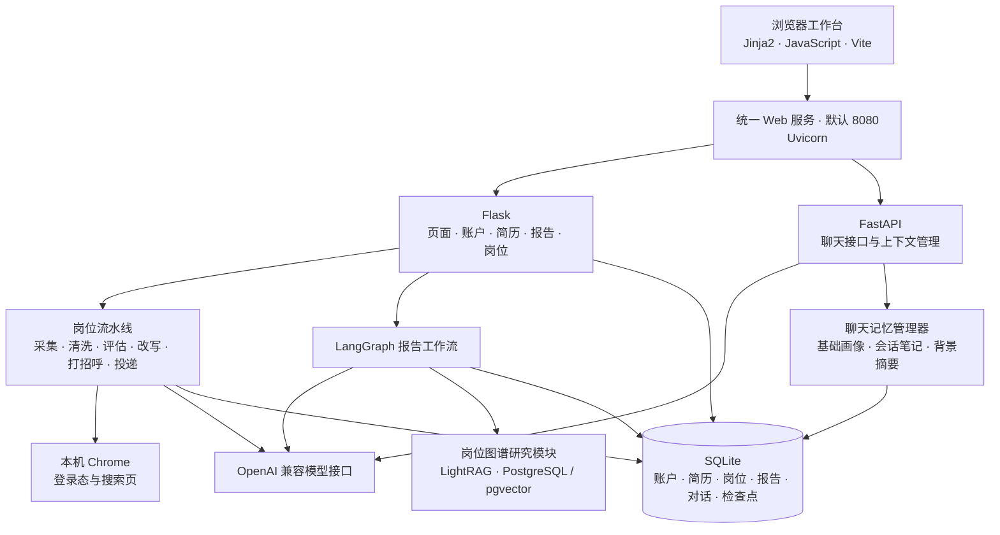

### 🗺️ 报告如何生成

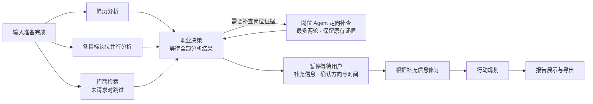

简历、目标岗位和招聘雷达并行分析，结果汇总后进入职业决策与行动规划。工作流保存检查点，支持失败重试、用户补充信息后继续执行。

<a id="configuration"></a>

## ⚙️ 模型与可选服务配置

### 模型配置入口

| 配置 | 何时需要 | 配置方式 |
| --- | --- | --- |
| 对话模型 | 聊天、简历分析、规划报告，以及流水线的 AI 评估 / 深评 / 简历改写 / 打招呼语 | 「系统配置」或 `AI_CHAT_BASE_URL`、`AI_CHAT_API_KEY`、`AI_CHAT_MODEL`。 |
| 招聘清洗模型 | 规则清洗的 AI 语义判定；配置不完整时沿用对话模型 | 「系统配置」或 `CLEANER_LLM_BASE_URL`、`CLEANER_LLM_API_KEY`、`CLEANER_LLM_MODEL`。 |
| 技能向量模型 | 技能对齐与岗位检索 | 「系统配置」或 `AI_EMBEDDING_BASE_URL`、`AI_EMBEDDING_API_KEY`、`AI_EMBEDDING_MODEL`。 |
| OCR | 扫描简历与图片导入识别；也可使用部署环境的 Tesseract | 「系统配置」或 `AI_OCR_BASE_URL`、`AI_OCR_API_KEY`、`AI_OCR_MODEL`。 |
| 新闻 embedding | 行业快报语义检索 | 参考 [新闻配置示例](.env.example)。 |

部署配置示例见 [.env.example](.env.example)。网页设置写入应用数据目录的 `model-settings.sqlite3`。密钥默认隐藏，系统管理员可以点击眼睛查看单个模型密钥。网页可编辑项在保存后生效，优先于进程环境和 `.env`，移除网页值可恢复部署配置。系统配置页也列出数据库、LightRAG 和外部 OCR 环境项，这些部署字段由环境管理。连通性测试使用已保存的模型配置，向服务商发送一条固定测试文本。白盒控制台只保留进程内近期请求的接口模板、状态和耗时，服务重启后清空。

### 实时采集配置

| 配置项 | 作用 |
| --- | --- |
| `CAREER_RECRUITMENT_USE_LOCAL_CHROME=1` | 启用本机 Chrome 登录态检查与后台采集（兼容旧配置 `CAREER_BOSS_USE_LOCAL_CHROME`）。 |
| `RESUME_REWRITE_SKILL_PATH` | 指定个人中心「简历改写」使用的 Skill 文件；也可在页面中导入自定义 Skill。 |

启用本机 Chrome 连接后，采集抽屉会为前程无忧、BOSS 直聘、智联招聘和小红书分别提供「检查登录」。需要手动登录或验证时，每个平台最多等待两分钟，超时会在采集记录中标明。采集会复用工作区的浏览器配置；关闭专用窗口或清除该配置后，需要重新登录。

### 按需启用服务

| 服务 | 启用条件 | 说明 |
| --- | --- | --- |
| 岗位图谱 | 本地 LightRAG、PostgreSQL / pgvector、模型配置和岗位材料 | 使用 `artifacts/research/job_graph.py` 抽取与导入。 |
| OCR | 安装 Tesseract 程序及所需语言数据，或配置 `AI_OCR_*` | 仅安装 Python 的 `pytesseract` 包不够。 |
| PostgreSQL | 岗位图谱或持久化图存储 | 由 Compose 的 `graph` profile 启动。 |

## 🧪 开发与测试

```bash
uv pip install pytest                 # 测试依赖，不在 requirements.txt 里
uv run --no-project python -m pytest  # 后端测试（约 30 秒）
npm run check                         # 前端静态检查与 TypeScript 类型检查
npm run test:unit                     # 前端单元测试
npm run test:browser --workspace frontend   # 浏览器测试，需要 Playwright 的 Chromium
```

<a id="development"></a>

## 📁 项目目录

```text
career-agent/
├── backend/
│   ├── server.py                 # 主站入口：创建应用、注册蓝图、启动
│   ├── advisor/                  # Agent、提示词、报告工作流与招聘雷达
│   ├── services/
│   │   ├── recruitment.py        # 招聘采集页面与平台接口
│   │   ├── recruitment_pipeline.py # 岗位全链路状态机、评估、改写、投递
│   │   ├── recruitment_cleaning.py # 硬规则与语义清洗
│   │   ├── recruitment_ai.py     # 清洗 / 初筛 / 深评的模型调用
│   │   ├── recruitment_chrome.py # 本机 Chrome 登录态与采集
│   │   ├── recruitment_sources.py # 平台入口、字段选择器与城市编码
│   │   ├── chat/                 # 聊天接口与三层记忆
│   │   ├── resume/               # 简历：解析、编辑器、改写、岗位匹配
│   │   ├── report/               # 报告：存储、追踪、写入、任务、导出
│   │   ├── job_market/           # 本地岗位库与采集调度
│   │   ├── user_state.py         # 工作区状态层：存储标识、状态文件与私有目录
│   │   ├── site.py  webshell.py  # 首页与启动数据；静态资源、Vite 标签与压缩
│   │   ├── pages.py  news/       # 独立页面与行业资讯
│   │   ├── interview.py          # 职业访谈与深度测评分析
│   │   ├── llm_calls.py          # 大模型调用：重试与结构化 JSON 修复
│   │   └── cors.py               # Flask 与聊天接口共用的跨域策略
│   ├── tests/                    # 后端测试（pytest）
│   ├── tools/                    # 招聘测试台与数据工作台
│   └── scripts/                  # 启动、管理员与数据构建脚本
├── frontend/
│   ├── templates/                # 页面与可复用 Jinja2 片段
│   ├── static/                   # 业务脚本、样式、媒体与构建资源
│   ├── scripts/                  # 前端静态检查与依赖同步
│   ├── tests/                    # 前端单元与浏览器测试
│   ├── src/entries/              # Vite 多页面入口
│   └── src/styles/               # 页面样式入口及静态样式导入
├── artifacts/research/           # 岗位图谱导入、查询与维护
├── data/
│   ├── jobs/                     # 城市岗位数据
│   ├── raw/                      # 原始数据及来源说明
│   ├── cleaned/                  # 清洗后的数据
│   ├── knowledge/                # 职业与行业分类资料
│   ├── onet/                     # O*NET 职业资料
│   ├── public/                   # 测评题库等公开资源
│   └── app_data/                 # 数据库、上传文件、报告、岗位缓存及对话
├── asserts/                      # README 页面截图
├── deploy/                       # Nginx 示例与静态导出目录
├── .github/workflows/ci.yml      # 持续集成配置（本地文件，被 .gitignore 排除）
├── requirements.txt              # Python 依赖（只列库名，不锁版本）
├── Dockerfile                    # 主站镜像（前端构建 + Python 运行）
├── .env.example                  # 环境配置模板
└── compose.yml                   # 主站容器部署及可选 PostgreSQL / pgvector
```

## 致谢

本项目参考并使用了以下开源项目，感谢作者的分享：

- [JobHunter](https://github.com/Bynlk/JobHunter)：招聘信息采集。
- [Jobhunter AI](https://github.com/jolie-z/jobhunter-ai/tree/main/backend)：招聘平台的搜索入口、字段规则与采集工作台参考。
- [xiaozhao-radar](https://github.com/jiabaobei/xiaozhao-radar)：校招数据聚合与招聘雷达。
- [LightRAG](https://github.com/HKUDS/LightRAG)：岗位知识图谱与检索。

第三方代码的许可证及版权声明保留在对应目录中。