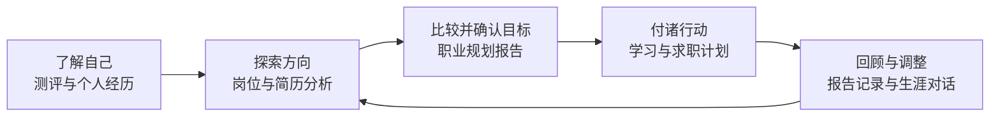
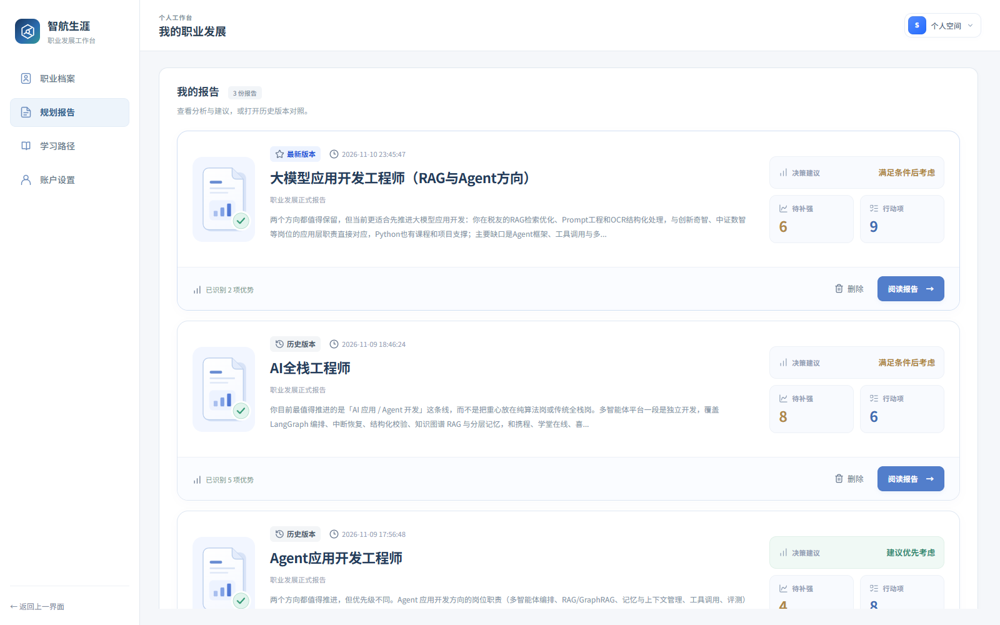
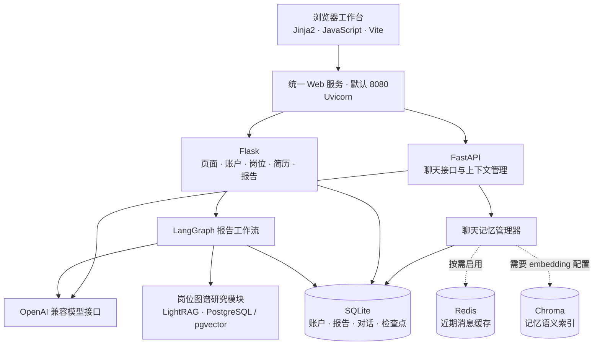
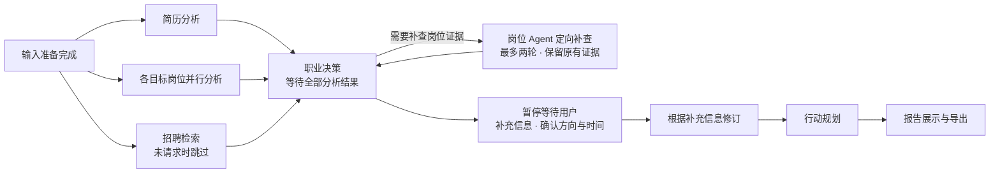

<div align="center">

# 🧭 智航生涯 · Career Planning

**从认识自己，到选择方向，再到落实下一步行动。**

职业测评 · 岗位探索 · 简历分析 · AI 规划报告 · 生涯对话

[功能一览](#features) · [快速启动](#quickstart) · [系统架构](#architecture) · [配置服务](#configuration) · [知识图谱初始化](#lightrag-setup) · [项目目录](#development)

[](requirements.txt)
[](package.json)
[](requirements.txt)
[](backend/services/chat/api.py)

[](frontend/vite.config.mjs)
[](backend/advisor/report_workflow.py)
[](https://github.com/hankwang712/Career-Planning/stargazers)

</div>


智航生涯是一个职业探索与求职准备工作台，结合个人经历、测评结果和岗位数据，帮助用户比较职业方向、生成规划报告并制定行动计划。

<a id="features"></a>

## ✨ 功能一览

| 模块 | 可以做什么 |
| --- | --- |
| 🧩 测评中心 | MBTI、霍兰德、深层 MBTI、老友记角色、情绪主导、SBTI 六项测评。保存答题进度、查看历史结果，基础测评支持最近两次结果对比。 |
| 🔎 岗位探索 | 定时获取公开招聘岗位，查看最新机会、样本行情、技能要求与来源时间，支持多维筛选和 Excel 导出。保留历史岗位档案与城市分析。 |
| 📄 简历分析 | 上传 PDF、DOCX 等简历，诊断经历深度、表达问题与证据缺口，给出有原文依据的修改建议。扫描文档可通过 OCR 读取。 |
| 🗺️ 职业规划报告 | 结合简历、目标和偏好分阶段生成报告，支持补充信息、确认方向、编辑润色、版本查看与 Word / PDF 导出。 |
| ✅ 行动与学习计划 | 根据阶段、目标和可投入时间安排近期任务，延伸到中长期成长路线。为准备事项提供交付成果与验收标准。 |
| 💬 AI 生涯助手 | 围绕职业选择、简历、面试和学习规划持续对话，结合工作台资料、简历与已保存记忆回答，支持图片输入。 |
| 📰 资讯与社区 | 查看职业资讯、相关新闻，发布求职经验、岗位讨论及回复。 |
| 👤 个人与管理中心 | 统一维护职业画像、技能证据、职业目标、测评和简历版本，追溯资料来源与修改历史。管理员管理账户及模型接口。 |



## 🖼️ 主要功能界面

主要业务界面截图更新于 **2026-11-11**，使用 **system 账号**当前界面与已有内容。下方 LightRAG 图谱保留独立样本演示。

| 实时岗位与行情 | 城市招聘分析 |
| :---: | :---: |
| [](asserts/jobs.png) | [](asserts/city-analysis.png) |

| 统一职业档案 | 技能与证据 |
| :---: | :---: |
| [](asserts/career-profile.png) | [](asserts/skill-evidence.png) |

| 六项职业与人格测评 | 简历材料与报告生成台 |
| :---: | :---: |
| [](asserts/assessments.png) | [](asserts/resume-analysis.png) |

| 职业规划报告 | 学习路径与任务板 |
| :---: | :---: |
| [](asserts/career-report.png) | [](asserts/learning.png) |

| AI 生涯助手 | Offer 茶水间 |
| :---: | :---: |
| [](asserts/assistant.png) | [](asserts/community.png) |

<details>
<summary>📰 查看行业资讯、报告卡片库与多智能体协作流程</summary>

**职业与行业快报**：按主题浏览技术、就业与职业成长资讯，保留来源和发布时间。

[](asserts/career-news.png)

**我的报告**：从报告卡片库打开已保存的报告，或对照历史版本。

[](asserts/report-library.png)

**报告协作流程**：从简历分析、岗位证据到目标确认、行动规划与报告合成，页面展示各阶段的执行状态。

[](asserts/agent-workflow.png)

</details>

<details>
<summary>🕸️ 查看 LightRAG 岗位知识图谱</summary>

岗位图谱将角色、技能、任务和能力要求关联起来，支持技能检索和岗位比较。

[](asserts/lightrag-career-graph.png)

图谱演示使用独立的 **200 条 JD** 样本。

</details>

<details>
<summary>🗃️ 查看数据集与规模</summary>

[](asserts/datasets.png)

数据经清洗、去重与统一字段处理后，形成 **81,296 条岗位记录 + 3,600 条分类知识**。以下数量对应当前仓库数据快照：

| 数据分类 | 最终记录数 |
| --- | ---: |
| 城市招聘样本 | 4,037 |
| 补充城市岗位 | 2,685 |
| 公开招聘快照 | 74,574 |
| 职业分类知识 | 1,827 |
| 行业分类知识 | 1,773 |

数据位于 `data/cleaned/merged/`，保留来源记录。招聘快照不代表岗位仍在招聘。

</details>

<a id="quickstart"></a>

## 🚀 快速启动

推荐 **Python 3.12 + Node.js 22 + uv**。需要 Redis 缓存或 LightRAG 图谱时，再安装 Docker Desktop（Windows / macOS）或 Docker Engine + Compose 插件（Linux）。以下命令均在项目根目录执行。

| 工具 | 负责什么 |
| --- | --- |
| uv | 安装 Python、创建 `.venv`、安装 Python 库。 |
| npm | 安装前端依赖、构建页面、启动主站。 |
| Docker Compose | 创建 PostgreSQL / pgvector 和 Redis 服务及持久化环境。主站在宿主机运行。 |

### 1. 安装 uv 并获取项目

安装 [uv](https://docs.astral.sh/uv/getting-started/installation/)（已安装可跳过）：

**Windows PowerShell**

```powershell
powershell -ExecutionPolicy ByPass -c "irm https://astral.sh/uv/install.ps1 | iex"
```

**macOS / Linux**

```bash
curl -LsSf https://astral.sh/uv/install.sh | sh
```

安装后重新打开终端，确认工具可用，再克隆项目：

```bash
uv --version
node --version
npm --version
git clone https://github.com/hankwang712/Career-Planning.git
cd Career-Planning
```

### 2. 创建 Python 环境并安装库

以下命令 Windows、macOS、Linux 通用：

```bash
uv python install 3.12
uv venv --python 3.12
uv pip install -r requirements.txt
npm ci
```


### 3. 配置环境和 Docker 服务

首次使用时复制配置文件（已有 `.env` 时跳过复制），再编辑其中的配置：

**Windows PowerShell**

```powershell
Copy-Item .env.example .env
```

**macOS / Linux**

```bash
cp .env.example .env
```

主站账户、报告和对话使用 SQLite，可先直接启动体验。需要聊天缓存或图谱时，先在 `.env` 填写 `POSTGRES_PASSWORD`，然后创建 Compose 使用的外部数据卷并启动服务：

```bash
docker --version
docker compose version
docker volume create research_career_pgdata
docker volume create career-agent-memory_memory-redis
docker compose up -d --wait postgres redis
docker compose ps
```


PostgreSQL 默认连接 `127.0.0.1:5432`，Redis 默认连接 `127.0.0.1:6380`。Docker 创建的是基础服务，图谱数据还需按[知识图谱初始化](#lightrag-setup)导入。

### 4. 构建并启动主站

```bash
npm run build
npm start
```

打开 **<http://localhost:8080>**。AI 对话、简历分析和报告生成需要配置模型。

### 5. 配置 AI 模型

```bash
uv run --no-project python backend/scripts/create_admin.py
```

按提示设置管理员邮箱和密码，登录后在工作台模型设置中填写 **接口地址、API Key、模型名称**，再选择模型。普通账户使用管理员提供的配置。

### 6. 修改前端时启用开发模式

**PowerShell**

```powershell
$env:USE_VITE_DEV_SERVER = "true"
npm start
```

**macOS / Linux**

```bash
USE_VITE_DEV_SERVER=true npm start
```

开发模式同时启动后端和 Vite，仍从 **8080** 访问系统。

<a id="architecture"></a>

## 🏗️ 系统架构与技术组成



### 🗺️ 报告如何生成



简历、目标岗位和招聘雷达并行分析，结果汇总后进入职业决策与行动规划。工作流保存检查点，支持失败重试、用户补充信息后继续执行。

招聘雷达合并 Radar 公开招聘汇总与 JobHunter 本地岗位库，按公司、岗位、城市、招聘批次和职位 ID 去重后筛选，再读取招聘链接核对内容。合并保留各来源及日期，不修改原始岗位库。岗位采集时间不代表公告发布日期或仍开放。JobHunter 尚未采集或岗位库暂不可用时，会说明缺项并继续使用 Radar。独立测试台启动命令：`python backend/tools/recruitment_lab/app.py`，访问 <http://127.0.0.1:8766/>。数据工作台位于 `/radar`，可手动同步、筛选及导入岗位。模型与可选正文提取服务使用根目录 `.env` 配置。

<a id="configuration"></a>

## ⚙️ 模型与可选服务配置

### 模型配置入口

| 配置 | 何时需要 | 配置方式 |
| --- | --- | --- |
| 主站对话模型 | AI 分析、对话与报告 | 管理员工作台模型设置。 |
| 聊天备用模型 | 没有主站模型配置时供聊天使用 | `AI_CHAT_BASE_URL`、`AI_CHAT_API_KEY`、`AI_CHAT_MODEL`。 |
| 聊天 embedding 模型 | 启用记忆语义检索 | `AI_EMBEDDING_BASE_URL`、`AI_EMBEDDING_API_KEY`、`AI_EMBEDDING_MODEL`。 |
| 新闻 embedding | 新闻语义检索 | 参考 [新闻配置示例](.env.example)。 |

配置统一放在根目录 `.env`，完整示例见 [.env.example](.env.example)。进程环境变量优先于文件配置，主站选定的模型优先于聊天备用模型。

### 按需启用服务

| 服务 | 启用条件 | 说明 |
| --- | --- | --- |
| Redis | 安装 Docker，启动下方 Compose 服务 | 用于近期消息缓存。不可用时，聊天记录仍由 SQLite 保存。 |
| Chroma 记忆索引 | 配置 embedding 接口 | 在后端进程中使用本地持久化索引，无需另启 Chroma 服务。未就绪时回退到已保存记忆和资料。 |
| 岗位图谱 | 本地 LightRAG、PostgreSQL / pgvector、模型配置和岗位材料 | 按下方[初始化说明](#lightrag-setup)安装固定版本并应用职业模块补丁，再调用 LLM 抽取。 |
| OCR | 安装 Tesseract 程序及所需语言数据 | 仅安装 Python 的 `pytesseract` 包不够。 |

**服务维护**（首次创建环境见[快速启动](#quickstart)）：

```bash
docker compose ps
docker compose logs --tail=100 postgres redis
docker compose stop
docker compose up -d --wait postgres redis
```

`stop` 停止服务，`up` 重新启动并复用数据卷。已有数据库中修改用户、密码或库名时，仅编辑 `.env` 不会修改已初始化的数据，需同步调整数据库。备份时同时保留 PostgreSQL 数据和下方职业事实库。

<a id="lightrag-setup"></a>

## 🕸️ LightRAG 知识图谱初始化与追加

<div>
<p><strong>首次克隆后，LightRAG 图谱为空，需要调用 LLM 抽取岗位材料。</strong>仓库中的岗位数据和图谱截图不等于已导入的知识库。当前未随仓库发布预处理数据库。</p>
<p>下列流程会调用你配置的文本模型抽取岗位、技能、任务和任职条件，再调用 embedding 接口生成向量，写入本地事实库和 PostgreSQL。建议先用少量 JD 验证接口，再扩大导入。模型调用会产生对应服务商的费用。</p>
</div>

### 1. 安装项目使用的 LightRAG

首次安装，在项目根目录执行：

```bash
git clone https://github.com/HKUDS/LightRAG.git artifacts/research/LightRAG
git -C artifacts/research/LightRAG checkout aaebfe1bb8d55deb6a4304d357a3bf4c92fcd40a
git -C artifacts/research/LightRAG apply --check ../patches/career-module.patch
git -C artifacts/research/LightRAG apply ../patches/career-module.patch
uv pip install -e "./artifacts/research/LightRAG[api]" asyncpg pgvector
```

补丁已包含职业模块；已有修改版请跳过克隆、切换提交和应用补丁。

可选：使用图谱网页需安装 [Bun](https://bun.sh/docs/installation)，并构建 WebUI：

```bash
cd artifacts/research/LightRAG/lightrag_webui
bun install --frozen-lockfile
bun run build
cd ../../../..
```

### 2. 配置文本模型、embedding 和数据库

在根目录 `.env` 填写以下配置（模板见 [.env.example](.env.example)）：

| 配置项 | 用途 |
| --- | --- |
| `LLM_BINDING_HOST`、`LLM_BINDING_API_KEY`、`LLM_MODEL` | OpenAI 兼容文本接口，用于职业事实抽取。 |
| `EMBEDDING_BINDING_HOST`、`EMBEDDING_BINDING_API_KEY`、`EMBEDDING_MODEL` | embedding 接口，用于向量化。 |
| `EMBEDDING_DIM`、`EMBEDDING_TOKEN_LIMIT` | 与所选 embedding 模型的实际维度、输入上限保持一致。 |
| `POSTGRES_HOST`、`POSTGRES_PORT`、`POSTGRES_USER`、`POSTGRES_PASSWORD`、`POSTGRES_DATABASE` | 与 Compose 启动的数据库一致。宿主机默认使用 `127.0.0.1:5432`。 |

管理员工作台的主站模型配置不会自动替代这里的 `LLM_*` / `EMBEDDING_*`。确认 PostgreSQL 服务健康。以下命令显式指定 `--workspace career_jd`，导入、查询和网页使用同一空间。

### 3. 准备 UTF-8 岗位文件

在项目根目录创建 `job_descriptions.txt`。每条岗位使用下列字段和空行，多条之间用**恰好 80 个等号**分隔：

```text
岗位名称：Python后端开发
企业：示例公司
城市：上海
学历：本科

岗位描述：
负责 Python API 开发，要求熟悉 FastAPI、PostgreSQL 和 Docker。
================================================================================

岗位名称：数据分析师
企业：另一家示例公司
城市：杭州
学历：本科

岗位描述：
使用 SQL 和 Python 分析业务数据，编写分析报告。
```

这是格式示例。实际导入时换成自己的岗位原文。`job_descriptions.txt` 默认不提交 Git。现有 `data/cleaned/merged/` 数据需整理为以上格式后导入，脚本不会自动扫描整个数据目录。

### 4. 预览、抽取和查看结果

先预览 2 条，检查格式（不调用模型、不连接数据库）：

```bash
uv run --no-project python artifacts/research/job_graph.py import --input job_descriptions.txt --workspace career_jd --limit 2 --preview
```

再抽取 2 条验证模型、向量和数据库配置：

```bash
uv run --no-project python artifacts/research/job_graph.py import --schema career --input job_descriptions.txt --workspace career_jd --limit 2
uv run --no-project python artifacts/research/job_graph.py career status --workspace career_jd
uv run --no-project python artifacts/research/job_graph.py career roles --workspace career_jd
```

确认成功后导入全部岗位。默认 `--limit 0` 表示读取到文件末尾。同一顺序、同一内容生成稳定记录 ID，已抽取成功的记录会复用事实，不重复进行 LLM 抽取：

```bash
uv run --no-project python artifacts/research/job_graph.py import --schema career --input job_descriptions.txt --workspace career_jd
```

可选启动图谱网页（完成 WebUI 构建后），访问 <http://127.0.0.1:9622>：

```bash
uv run --no-project python artifacts/research/job_graph.py serve --schema career --workspace career_jd
```

### 5. 后续追加岗位与失败重试

将新岗位追加到原文件末尾，保留旧记录的顺序和内容，再运行同一条全量导入命令即可。也可用 `--start` 从指定序号继续，例如旧文件有 200 条，新增 20 条：

```bash
uv run --no-project python artifacts/research/job_graph.py import --schema career --input job_descriptions.txt --workspace career_jd --start 201 --limit 20
```

失败记录默认不会自动重试。修复接口或配置后显式重试，服务限流时可将抽取并发降为 1：

```bash
uv run --no-project python artifacts/research/job_graph.py import --schema career --input job_descriptions.txt --workspace career_jd --retry-failed --extract-workers 1
```

职业事实保存在 `artifacts/research/.job_graph/career.sqlite3`，图和向量保存在 PostgreSQL，运行文件位于 `artifacts/research/jd_rag_storage/`。保留事实库才能在后续导入时复用结果。这些运行数据默认不提交 Git。不要在同一空间随意换用重新排序的文件、岗位分类目录或不同维度的 embedding 模型。独立实验请更换 `--workspace`，更换模型维度时还需隔离数据库。完整参数见 `uv run --no-project python artifacts/research/job_graph.py import --help`。

安装与部署写法参考 [FastAPI 全栈模板](https://github.com/fastapi/full-stack-fastapi-template/blob/master/backend/README.md)、[LightRAG](https://github.com/HKUDS/LightRAG) 和 [Docker Compose 官方指南](https://docs.docker.com/compose/gettingstarted/)，命令按本仓库实际入口整理。

<a id="development"></a>

## 📁 项目目录

```text
career-agent/
├── backend/
│   ├── server.py                 # 主站入口、页面路由与业务接口
│   ├── advisor/                  # Agent、提示词、报告工作流与招聘雷达
│   ├── services/                 # 聊天、简历、报告、岗位与资讯服务
│   ├── tools/                    # 招聘测试台与数据工作台
│   └── scripts/                  # 启动、管理员与数据构建脚本
├── frontend/
│   ├── templates/                # 页面与可复用 Jinja2 片段
│   ├── static/                   # 业务脚本、样式、媒体与构建资源
│   ├── src/entries/              # Vite 多页面入口
│   └── src/styles/               # 页面样式入口及静态样式导入
├── artifacts/research/           # 岗位图谱导入、查询与维护
├── data/
│   ├── jobs/                     # 城市岗位数据
│   ├── raw/                      # 原始数据及来源说明
│   ├── cleaned/                  # 清洗后的数据
│   ├── knowledge/                # 职业与行业分类资料
│   ├── onet/                     # O*NET 职业资料
│   ├── public/                   # 测评题库等公开资源
│   └── app_data/                 # 数据库、上传文件、报告及对话
├── asserts/                      # README 页面截图
├── deploy/                       # Nginx 示例与静态导出目录
├── requirements.txt              # Python 依赖
├── .env.example                  # 环境配置模板
└── compose.yml                   # PostgreSQL / pgvector 与 Redis
```

## 致谢

本项目参考并使用了以下开源项目，感谢作者的分享：

- [JobHunter](https://github.com/Bynlk/JobHunter)：招聘信息采集。
- [xiaozhao-radar](https://github.com/jiabaobei/xiaozhao-radar)：校招数据聚合与招聘雷达。
- [LightRAG](https://github.com/HKUDS/LightRAG)：岗位知识图谱与检索。

第三方代码的许可证及版权声明保留在对应目录中。
