<div align="center">

# 🧭 智航生涯 · Career Planning

**从认识自己，到选择方向，再到落实下一步行动。**

职业测评 · 岗位探索 · 简历分析 · AI 规划报告 · 生涯对话

[功能一览](#features) · [快速启动](#quickstart) · [系统架构](#architecture) · [配置服务](#configuration) · [项目目录](#development)

[](backend/requirements.txt)
[](package.json)
[](backend/requirements.txt)
[](backend/services/chat/api.py)

[](frontend/vite.config.mjs)
[](experiments/news_advisor/report_workflow.py)
[](https://github.com/hankwang712/Career-Planning/stargazers)

</div>

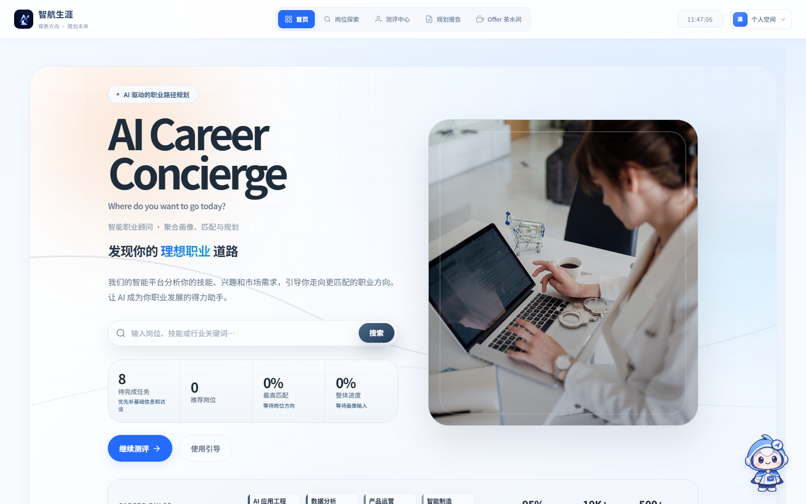

智航生涯是一个面向职业探索与求职准备的 Web 工作台，将个人经历、测评结果、岗位数据和 AI 分析放在同一条使用流程中。用户可以比较职业方向、生成规划报告，并将选定方向拆解为学习与求职任务。

<a id="features"></a>

## ✨ 功能一览

| 模块 | 可以做什么 |
| --- | --- |
| 🧩 测评中心 | MBTI、霍兰德、深层 MBTI、老友记角色、情绪主导、SBTI 六项测评；保存答题进度、查看历史结果，基础测评支持最近两次结果对比。 |
| 🔎 岗位探索 | 定时获取公开招聘岗位，查看最新机会、样本行情、技能要求与来源时间，支持多维筛选和 Excel 导出；保留历史岗位档案与城市分析。详见[最新岗位与行情观察](docs/job-market.md)。 |
| 📄 简历分析 | 上传 PDF、DOCX 等简历，诊断经历深度、表达问题与证据缺口，给出有原文依据的修改建议；扫描文档可通过 OCR 读取。 |
| 🗺️ 职业规划报告 | 结合简历、目标和偏好分阶段生成报告，支持补充信息、确认方向、编辑润色、版本查看与 Word / PDF 导出。 |
| ✅ 行动与学习计划 | 根据阶段、目标和可投入时间安排近期任务，延伸到中长期成长路线；为准备事项提供交付成果与验收标准。 |
| 💬 AI 生涯助手 | 围绕职业选择、简历、面试和学习规划持续对话，结合工作台资料、简历与已保存记忆回答，支持图片输入。 |
| 📰 资讯与社区 | 查看职业资讯、相关新闻，发布求职经验、岗位讨论及回复。 |
| 👤 个人与管理中心 | 统一维护职业画像、技能证据、职业目标、测评和简历版本，追溯资料来源与修改历史；管理员管理账户及模型接口。详见[职业档案设计](docs/career-profile.md)。 |

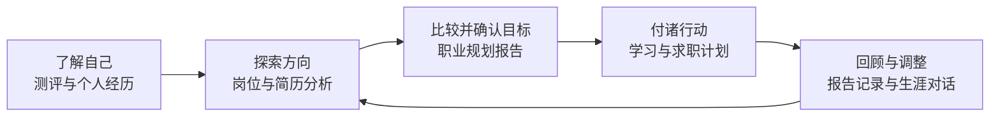

测评用于提供探索线索，职业建议还需要结合简历与岗位证据。报告中的招聘样本用于说明检索到的岗位要求，不代表全市场招聘规模或薪资趋势。

## 🖼️ 主要功能界面

以下截图更新于 **2026-11-06**。职业档案、规划报告与对话使用匿名演示资料，岗位和资讯展示截图时的数据快照。点击图片可查看大图。

| 实时岗位与行情 | 城市招聘分析 |
| :---: | :---: |
| [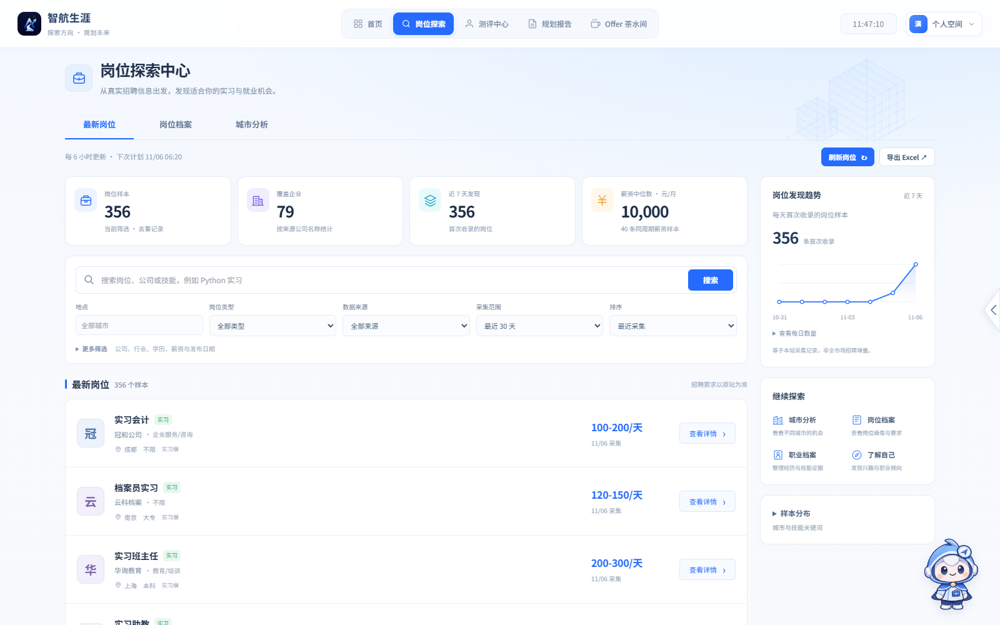](asserts/jobs.png) | [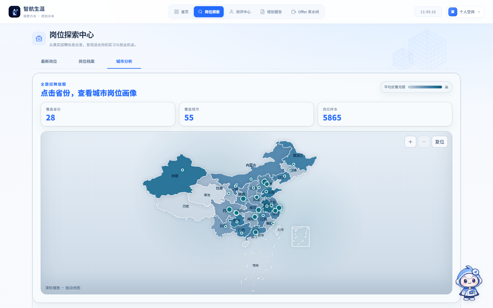](asserts/city-analysis.png) |

| 统一职业档案 | 技能与证据 |
| :---: | :---: |
| [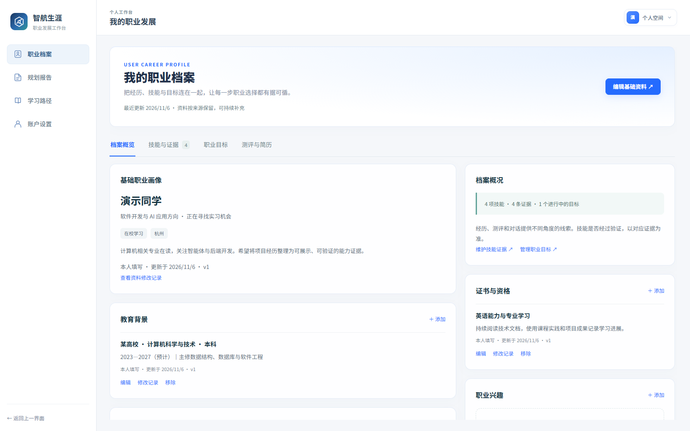](asserts/career-profile.png) | [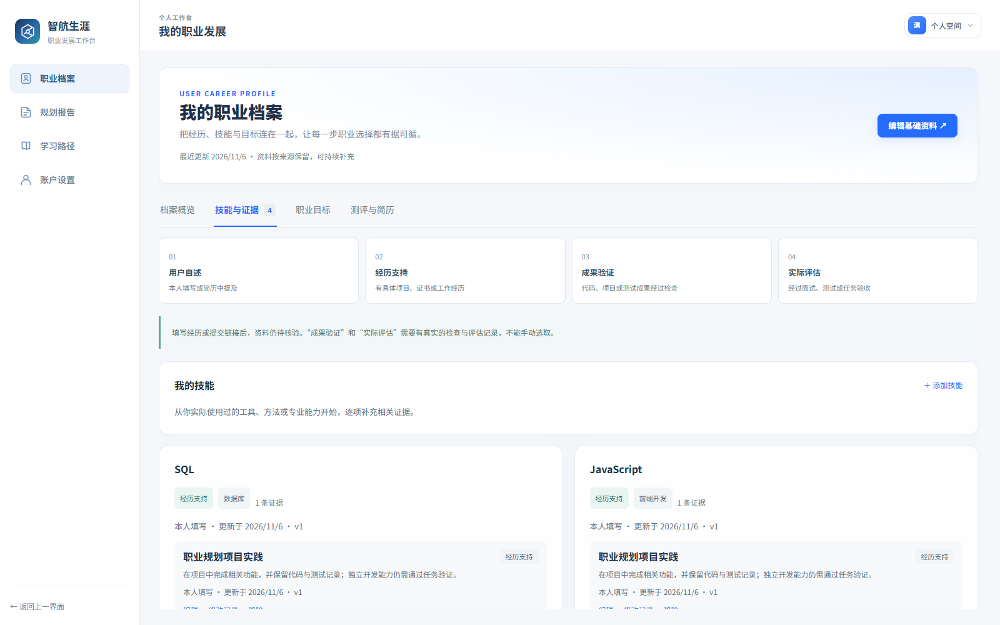](asserts/skill-evidence.png) |

| 六项职业与人格测评 | 简历材料与报告生成台 |
| :---: | :---: |
| [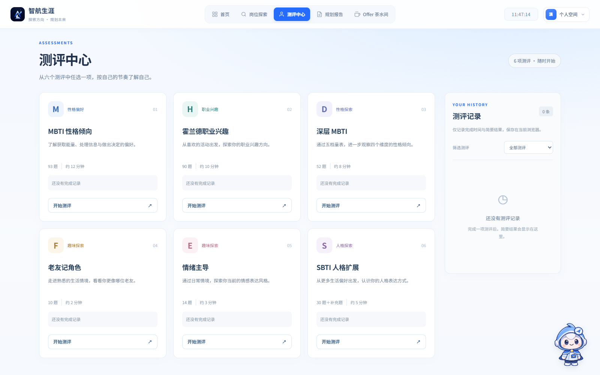](asserts/assessments.png) | [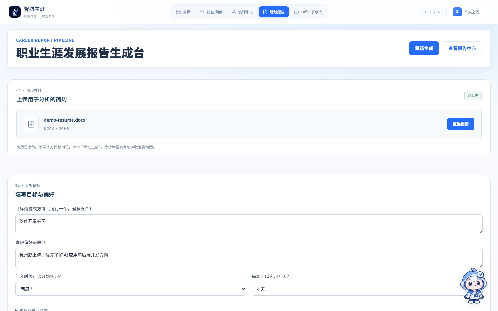](asserts/resume-analysis.png) |

| 职业规划报告 | 学习路径与任务板 |
| :---: | :---: |
| [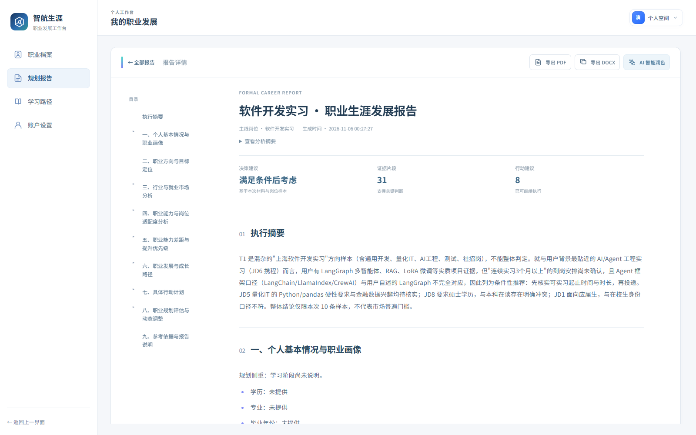](asserts/career-report.png) | [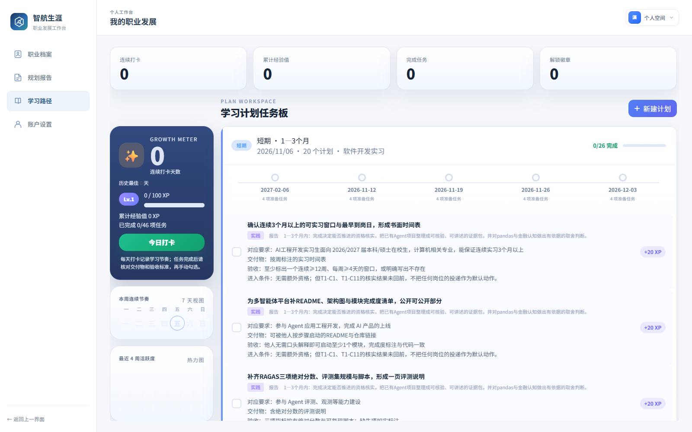](asserts/learning.png) |

| AI 生涯助手 | Offer 茶水间 |
| :---: | :---: |
| [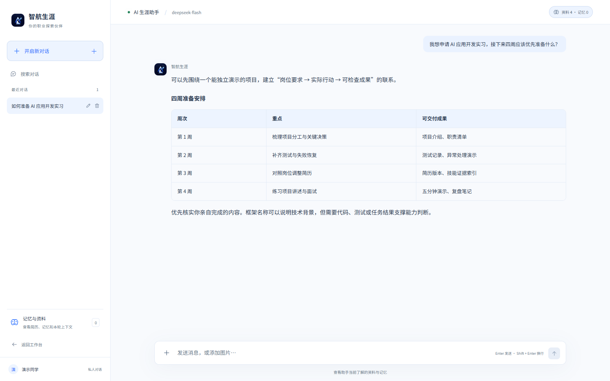](asserts/assistant.png) | [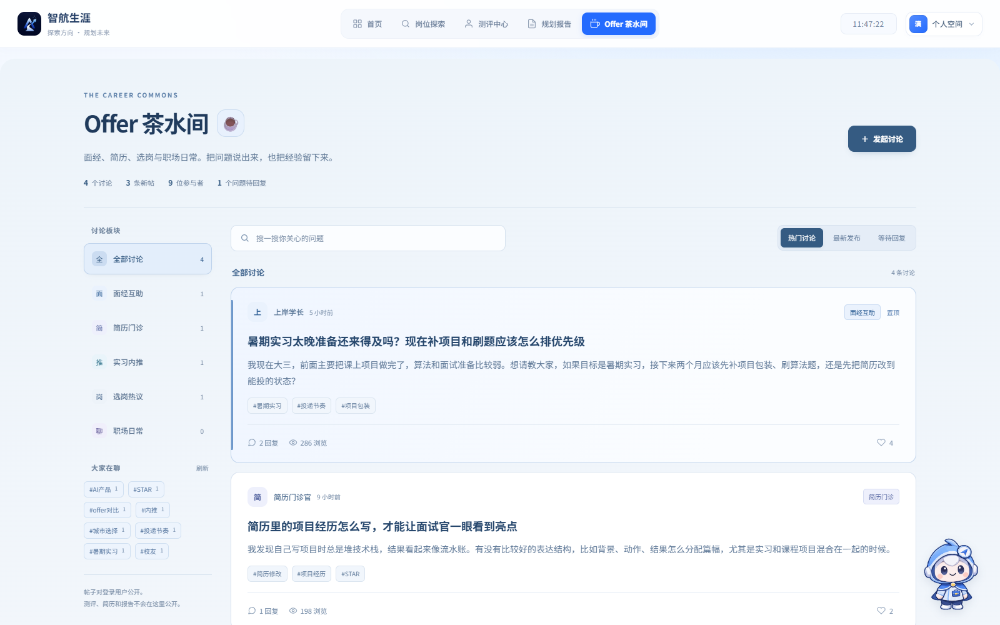](asserts/community.png) |

<details>
<summary>📰 查看行业资讯与多智能体协作流程</summary>

**职业与行业快报**：按主题浏览技术、就业与职业成长资讯，保留来源和发布时间。

[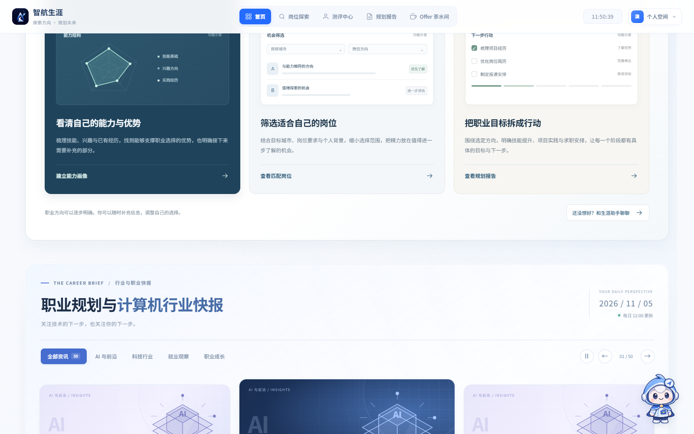](asserts/career-news.png)

**报告协作流程**：从简历分析、岗位证据到目标确认、行动规划与报告合成，页面展示各阶段的执行状态。

[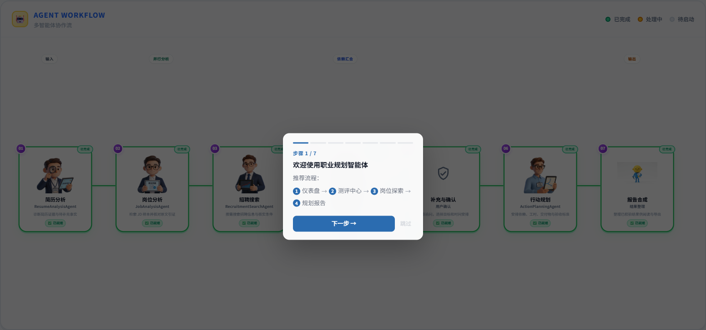](asserts/agent-workflow.png)

</details>

<details>
<summary>🕸️ 查看 LightRAG 岗位知识图谱</summary>

项目将岗位材料中的角色、技能、任务和能力要求组织成可检索图谱，结合原始 JD 证据进行职业画像、技能反查和岗位比较。下图为当前 `career_jd` 知识库的 LightRAG 实际界面。

[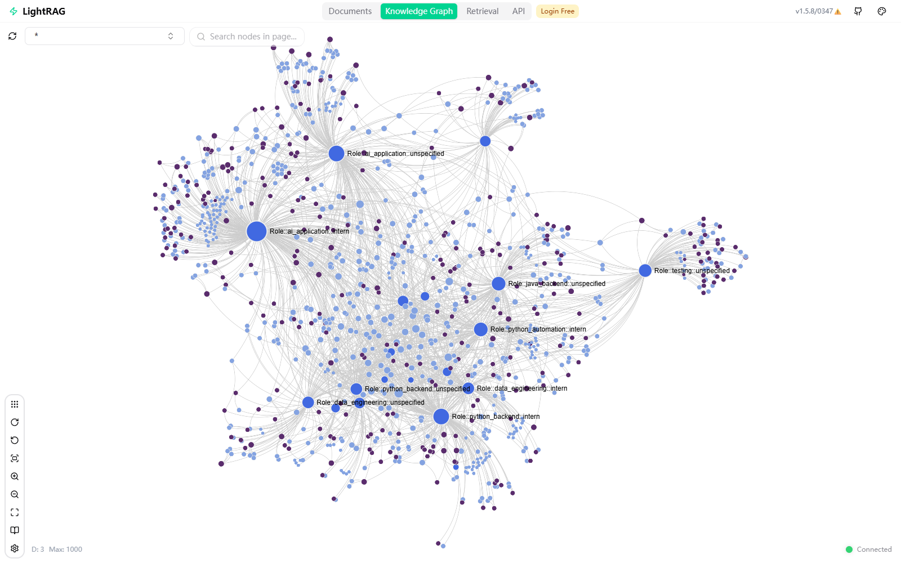](asserts/lightrag-career-graph.png)

图谱演示使用独立的 JD 样本集；当前职业事实库包含 **200 条已抽取 JD**，与下方完整岗位数据集的统计范围不同。

</details>

<details>
<summary>🗃️ 查看最终数据集：页面、规模与记录示例</summary>

[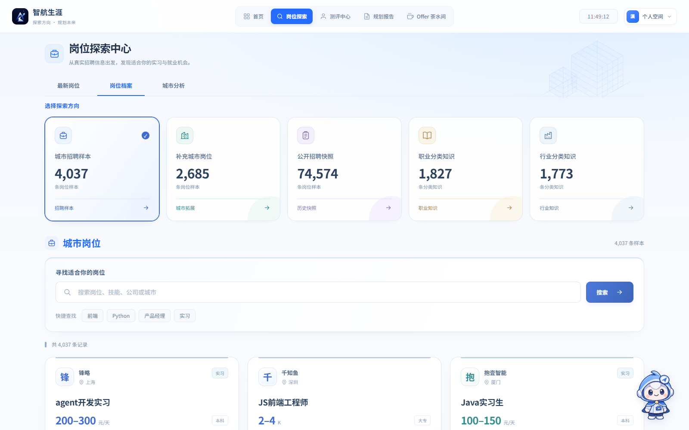](asserts/datasets.png)

数据经清洗、去重与统一字段处理后，形成 **81,296 条岗位记录 + 3,600 条分类知识**。以下数量对应当前仓库数据快照：

| 数据分类 | 最终记录数 |
| --- | ---: |
| 城市招聘样本 | 4,037 |
| 补充城市岗位 | 2,685 |
| 公开招聘快照 | 74,574 |
| 职业分类知识 | 1,827 |
| 行业分类知识 | 1,773 |

岗位以 `jobs.jsonl.gz` 保存，分类知识以 `knowledge.jsonl` 保存，`summary.json` 记录合并统计。文件位于 `data/cleaned/merged/`，由主站数据集浏览器按需读取。招聘快照不代表岗位仍在招聘，缺失字段不补写为已知事实。

下面截取一条实际岗位记录的部分字段；`sources` 保留来源文件与记录位置：

```json
{
  "id": "job_ecf03b34992e5a868decf640",
  "title": "python开发实习生",
  "company": "若轻信息",
  "locations": ["上海"],
  "salary": "3-8K",
  "education": "本科",
  "experience": "在校/应届",
  "skills": ["Nginx", "Docker", "MySQL", "Linux开发/部署经验", "Python"],
  "sources": [
    {
      "dataset": "city_jobs",
      "file": "data/jobs/上海.json",
      "row": 1,
      "record_id": "2"
    }
  ]
}
```

</details>

<a id="quickstart"></a>

## 🚀 快速启动

推荐 **Python 3.12 + Node.js 22**，与仓库 CI 环境一致。以下命令均在项目根目录执行。

### 1. 安装依赖

**Windows PowerShell**

```powershell
python -m venv .venv
.\.venv\Scripts\Activate.ps1
python -m pip install -r backend/requirements.txt
npm ci
```

<details>
<summary>macOS / Linux 命令</summary>

```bash
python3 -m venv .venv
source .venv/bin/activate
python -m pip install -r backend/requirements.txt
npm ci
```

</details>

`backend/requirements.txt` 会引用 `experiments/requirements-resume.txt`，请保留完整仓库目录。

### 2. 构建并启动

```bash
npm run build
npm start
```

打开 **<http://localhost:8080>**。终端保持运行，按 `Ctrl+C` 停止服务。

`npm start` 默认启动后端并使用 `frontend/static/dist/` 中的构建资源。基础页面与普通测评可先体验；AI 对话、简历分析和报告生成需要配置可用模型。

### 3. 配置 AI 模型

```bash
python backend/scripts/create_admin.py
```

按提示设置管理员邮箱和密码，登录后在工作台模型设置中填写 **接口地址、API Key、模型名称**，再选择模型。普通账户使用管理员提供的配置。

该脚本也会更新同邮箱的已有账户密码和管理员角色，并撤销其旧登录会话。

### 4. 修改前端时启用开发模式

**PowerShell**

```powershell
$env:USE_VITE_DEV_SERVER = "true"
npm start
```

**macOS / Linux**

```bash
USE_VITE_DEV_SERVER=true npm start
```

开发模式同时启动后端和 Vite，仍从 **8080** 进入系统；Vite 默认使用 **5173**。Vite 管理的资源支持热更新，模板及直接加载的静态脚本修改后按需刷新页面。

| 启动方式 | 用途 |
| --- | --- |
| `npm start` | 启动完整 Web 服务，默认使用已构建前端。 |
| `python backend/server.py` | 直接启动后端入口，提供 FastAPI 聊天接口和 Flask 主站。 |
| `npm run dev` | 仅启动 Vite，业务功能仍需要后端。 |

<a id="architecture"></a>

## 🏗️ 系统架构与技术组成

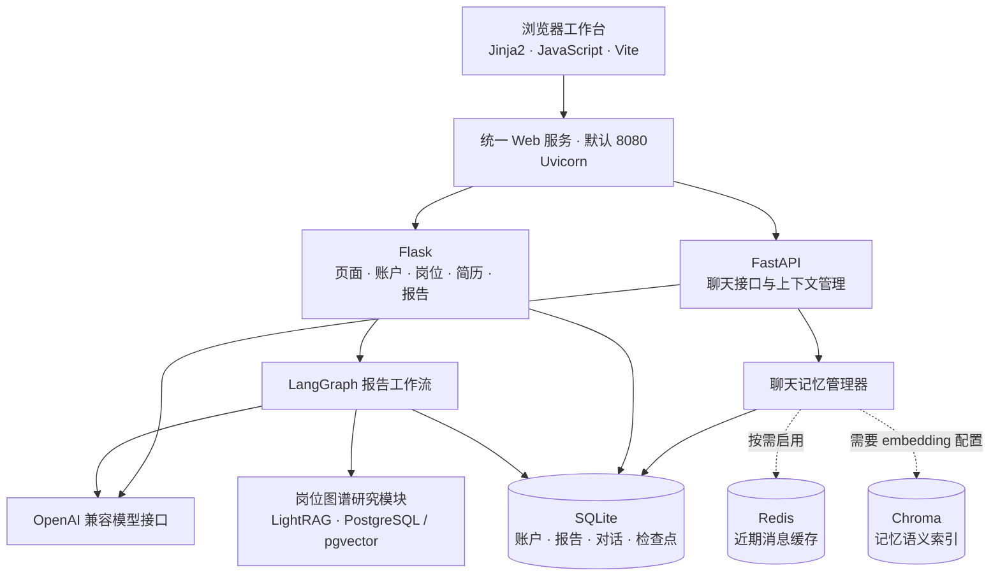

| 层次 | 使用内容 | 主要位置 |
| --- | --- | --- |
| 前端 | 原生 JavaScript、Jinja2、Vite、Tailwind CSS、PostCSS | `frontend/templates/`、`frontend/static/`、`frontend/src/` |
| 后端 | Flask、FastAPI、Uvicorn、Pydantic | `backend/server.py`、`backend/services/` |
| AI 与工作流 | OpenAI SDK、LangChain、LangGraph、SQLite 检查点 | `backend/services/report/`、`experiments/news_advisor/` |
| 聊天记忆 | SQLite 持久化、Redis 缓存、Chroma 语义索引 | `backend/services/chat/` |
| 岗位数据与图谱 | 城市岗位数据、职业知识、LightRAG、PostgreSQL / pgvector | `data/`、`artifacts/research/` |
| 文档处理 | PyMuPDF、pypdf、pdfplumber、python-docx、docx2pdf、Tesseract OCR | `backend/services/resume/`、`backend/services/report/exporters.py` |
| 图表与交互 | ECharts、Chart.js、Fuse.js、GSAP | `frontend/static/` |
| 资讯处理 | feedparser、trafilatura、readability-lxml、lxml | `backend/services/news/` |
| 构建与部署 | npm workspaces、GitHub Actions、Docker Compose、Nginx | `package.json`、`.github/workflows/`、`deploy/` |

### 🗺️ 报告如何生成

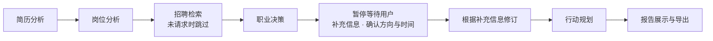

工作流通过 SQLite 检查点保存状态，在用户确认后恢复执行。报告包含个人画像、目标定位、就业市场、岗位适配、能力差距、成长路径、行动计划、动态评估、参考依据，并附执行摘要。生成时保留资料快照和报告版本，便于核对结论来源。

### 🧠 聊天记忆目前支持什么

| 已有能力 | 当前边界 |
| --- | --- |
| 聊天历史、近期上下文、增量会话摘要 | 摘要主要维持当前会话连续性。 |
| 跨会话的用户事实、职业偏好、交流偏好 | 以用户明确陈述和原话证据为基础，不把助手建议直接记成用户事实。 |
| 新增、去重、补充、替换、冲突处理和变更记录 | 暂无完整的记忆自动过期与定期归档机制。 |
| 用户查看、纠正、遗忘和删除；缓存与索引清理重试 | 外部服务不可用时，可能显示清理待完成状态。 |
| 已保存记忆的语义召回及无向量服务时的回退 | 尚未形成独立的跨会话情景记忆、决策记录与结构化任务进度系统。 |

主站聊天记忆位于 `backend/services/chat/`。`experiments/news_advisor/memory/` 是另一套实验模块，调整主站聊天时应先从主站实现入手。

<a id="configuration"></a>

## ⚙️ 模型与可选服务配置

### 模型配置入口

| 配置 | 何时需要 | 配置方式 |
| --- | --- | --- |
| 主站对话模型 | AI 分析、对话与报告 | 管理员工作台模型设置。 |
| 聊天备用模型 | 没有主站模型配置时供聊天使用 | `AI_CHAT_BASE_URL`、`AI_CHAT_API_KEY`、`AI_CHAT_MODEL`。 |
| 聊天 embedding 模型 | 启用记忆语义检索 | `AI_EMBEDDING_BASE_URL`、`AI_EMBEDDING_API_KEY`、`AI_EMBEDDING_MODEL`。 |
| 文生图模型 | 职业画像海报 | `TEXT_TO_IMAGE_API_KEY`、`TEXT_TO_IMAGE_BASE_URL`、`TEXT_TO_IMAGE_MODEL`；可用 `PROFILE_PORTRAIT_MODEL` 单独指定画像模型。 |
| 新闻 embedding | 新闻语义检索 | 参考 [新闻配置示例](backend/news.env.example)。 |

聊天配置格式见 [backend/chat.env.example](backend/chat.env.example)。主站选定的模型优先于聊天备用配置。聊天与 embedding 配置也读取 `experiments/.env`，进程环境变量优先；示例文件不会自动加载。

<details>
<summary>🔧 常用运行环境变量</summary>

| 变量 | 用途 |
| --- | --- |
| `HOST` / `PORT` | 后端地址和端口，默认 `0.0.0.0:8080`。 |
| `APP_SECRET_KEY` / `SECRET_KEY` | 会话签名密钥；未设置时使用数据库中保存的密钥。 |
| `USE_VITE_DEV_SERVER` | 设为 `true`，启动脚本同时运行 Vite。 |
| `VITE_DEV_SERVER_URL` | 自定义 Vite 地址，同时启用前端开发模式。 |
| `FRONTEND_ORIGIN` | 前后端分离部署时允许的前端来源。 |
| `SESSION_COOKIE_SECURE` | HTTPS 部署时启用 Secure Cookie。 |
| `CHAT_REDIS_URL` | 聊天缓存，默认 `redis://127.0.0.1:6380/0`。 |
| `TESSERACT_CMD` | Tesseract 程序路径，OCR 使用。 |

</details>

### 按需启用服务

| 服务 | 启用条件 | 说明 |
| --- | --- | --- |
| Redis | 安装 Docker，启动下方 Compose 服务 | 用于近期消息缓存；不可用时，聊天记录仍由 SQLite 保存。 |
| Chroma 记忆索引 | 配置 embedding 接口 | 在后端进程中使用本地持久化索引，无需另启 Chroma 服务；未就绪时回退到已保存记忆和资料。 |
| 岗位图谱 | 本地 LightRAG、PostgreSQL / pgvector、研究配置和岗位材料 | 入口见 `artifacts/research/job_graph.py`；LightRAG 检出目录为 `artifacts/research/LightRAG/`，不随主仓库提供。 |
| OCR | 安装 Tesseract 程序及所需语言数据 | 仅安装 Python 的 `pytesseract` 包不够。 |
| PDF 导出 | `docx2pdf` 转换环境 | 当前通过 DOCX 转 PDF；Windows 需要 Microsoft Word，DOCX 本身由 `python-docx` 生成。 |

**单独启动 Redis**：当前 Compose 使用外部数据卷，首次运行需先创建。

```bash
docker volume create career-agent-memory_memory-redis
docker compose -f experiments/compose.memory.yml up -d redis
```

根目录 `compose.yml` 组合了图谱数据库和 Redis，依赖它引用的环境文件及数据卷，**不会构建或启动主站应用**。先跑通主站，再按需配置图谱服务。

<a id="development"></a>

## 📁 项目目录

```text
career-agent/
├── backend/
│   ├── server.py                 # 主站入口、页面路由与业务接口
│   ├── services/
│   │   ├── chat/                 # 聊天、资料上下文、记忆与隐私
│   │   ├── resume/               # 简历解析、事实与匹配
│   │   ├── report/               # 报告接入、规划、审阅、导出
│   │   └── news/                 # 资讯采集与知识检索
│   └── scripts/                  # 启动、管理员、数据构建与检查
├── frontend/
│   ├── templates/                # 页面与可复用 Jinja2 片段
│   ├── static/                   # 业务脚本、样式、媒体与构建资源
│   ├── src/entries/              # Vite 多页面入口
│   └── src/styles/               # 页面样式入口及静态样式导入
├── experiments/
│   ├── news_advisor/             # 主站复用的 Agent、Prompt 和报告图
│   └── rag_benchmark/            # 检索评估实验
├── artifacts/research/           # 岗位图谱导入、查询与维护
├── data/
│   ├── jobs/                     # 城市岗位数据
│   ├── raw/                      # 原始数据及来源说明
│   ├── cleaned/                  # 清洗后的数据
│   ├── knowledge/                # 职业与行业分类资料
│   ├── onet/                     # O*NET 职业资料
│   ├── public/                   # 测评题库等公开资源
│   └── app_data/                 # 数据库、上传文件、报告及对话
├── asserts/                      # README 页面截图
├── deploy/                       # Nginx 示例与静态导出目录
└── .github/workflows/            # CI 检查
```

`experiments/news_advisor/` 已有代码被主站直接导入，不能作为纯演示目录随意移除。`data/app_data/`、环境配置、依赖目录和构建产物由 `.gitignore` 排除；迁移环境时需单独备份运行数据及配置。
