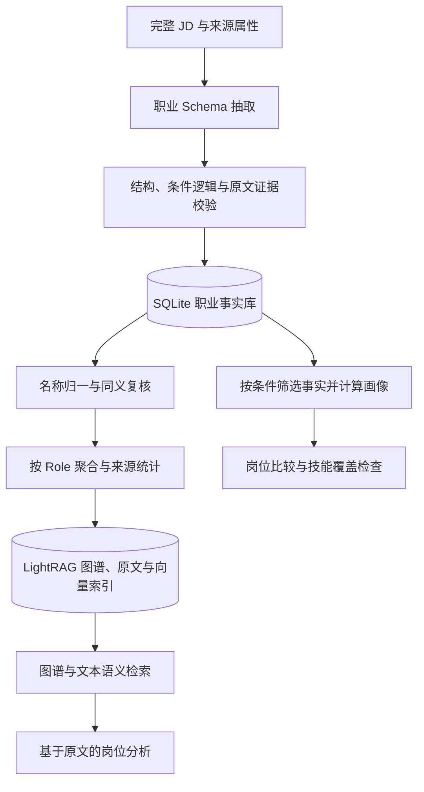
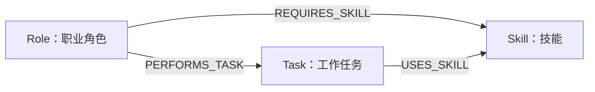

<div align="center">

# LightRAG 职业知识图谱

</div>

以完整 JD 为证据，构建 Role、Skill、Task 职业图谱，支持岗位画像、条件筛选和原文检索。环境与命令见[主项目 README](../../README.md#lightrag-setup)。

<a id="overview"></a>

## 1. 构建全貌



LLM 提取职业事实，程序校验与统计，LightRAG 负责索引和召回，主站 Agent 结合证据分析。

相比通用流程，本项目采用完整 JD 分块、受控职业模型和逐字证据校验。先保存事实，再聚合发布。结构化统计与语义检索分开处理，图谱可由已有事实重建。

<a id="data"></a>

## 2. 数据组织：完整 JD 与元数据

### 2.1 完整 JD 分块

**一条 JD 为一个逻辑 Chunk**，保留标题、企业、城市、学历与完整描述，避免职责和“优先、任选、否定”等限定词被切散。

输入为根目录 UTF-8 文件 `job_descriptions.txt`，记录之间用 **80 个 `=`** 和空行分隔。

<details>
<summary><strong>展开查看：两条 JD 的输入格式</strong></summary>

```text
岗位名称：Python后端开发
企业：示例公司
城市：上海
学历：本科

岗位描述：
负责使用 Python 开发 API。熟悉 SQL，掌握 Pandas 或 Polars 任意一种者优先。
================================================================================

岗位名称：数据分析师
企业：另一家示例公司
城市：杭州
学历：本科

岗位描述：
使用 SQL 处理业务数据，并完成分析报告。
```

</details>

### 2.2 节点与元数据

职业关系建成节点和边。城市、学历等作为 JD 的 **metadata（元数据）**，用于筛选与追溯。

| 信息 | 保存方式 | 当前用途 |
| --- | --- | --- |
| 职业类别、技能、任务 | Role、Skill、Task 节点 | 表达岗位能力结构及跨岗位联系。 |
| 城市、学历 | JD 属性，同时保留在原文中 | 职业结构化查询支持精确筛选，筛选后重新聚合。 |
| 企业、招聘标题 | JD 属性，同时保留在原文中 | 保留招聘背景与来源语义。当前职业结构化查询没有专门的企业过滤参数。 |
| 来源文件、记录序号、记录标识 | 来源与身份信息 | 回溯原文、区分记录、复用已有抽取结果。 |
| 要求性质、条件逻辑、熟练程度 | 要求组及关系上的条件信息 | 区分必需、优先、任选与举例，解释具体要求。 |

例如，“上海、本科的数据工程岗位”先按属性选出 JD，再计算画像。城市无需建成节点。结构化筛选与语义召回的支持范围见[第 6 节](#retrieval)。

<a id="schema"></a>

## 3. 图谱模型：岗位、技能、任务与条件

### 3.1 节点与关系

| 节点 | 回答的问题 | 示例 |
| --- | --- | --- |
| **Role** | 这是什么职业方向与明确职级？ | 数据工程 · 层级未注明 |
| **Skill** | 工作涉及什么技术、工具、方法或能力？ | Python、SQL、Pandas |
| **Task** | 岗位实际要完成什么事情？ | 开发数据处理流程 |

Role 按正文职责归类。职级仅记录原文明示层级，否则为 `unspecified`。无法可靠分类的记录保留事实，不参与 Role 画像聚合。



岗位—技能边保留要求组，不表示技能一定必需。岗位—任务边需有职责证据。任务—技能边需有明确使用依据，共同出现不足以建边。

### 3.2 要求组

> 熟悉 SQL，掌握 Pandas 或 Polars 任意一种者优先。

这句话拆成两组条件：

| 条件组 | 技能 | 性质 | 组内逻辑 |
| --- | --- | --- | --- |
| A | SQL | 根据“熟悉 SQL”记录相应要求与程度 | AND：单技能 |
| B | Pandas、Polars | preferred：优先 | OR：任选其一 |

**Requirement Group 不单独建节点**，在事实和关系中保存条件与原句，避免将“任选且优先”变成逐项必备。

要求组区分两个维度：

- **要求性质**：`required` 必需、`preferred` 优先、`mentioned` 提及、`negated` 否定、`uncertain` 不确定。
- **组合逻辑**：`AND` 全部要求、`OR` 任选其一、`EXAMPLE_SET` 工具举例、`ALTERNATIVE_UNCONFIRMED` 替代关系不明确。

“了解、熟悉、熟练”等程度保留原文措辞。

<a id="construction"></a>

## 4. 构建过程：抽取、校验、归一与聚合

### 4.1 抽取与校验

模型按受控 Schema 输出职业事实。程序检查结构、Role 目录、技能引用和条件逻辑。

证据必须是**当前 JD 中逐字连续的原文**。校验失败后携带反馈重试，默认最多 3 次。仍失败则记录状态，不发布不完整事实。

引用校验不等于语义正确，重要分析仍需抽样复核。

### 4.2 名称归一

1. **规则归一**：统一类型限定的已知别名、大小写与规范名，例如 `Python语言 → Python`。
2. **候选召回**：通过相似度找出值得比较的实体对，相似度本身不代表同义。
3. **证据复核与映射**：结合双方原文和概念边界决定是否合并，保留规范 ID、审核历史和撤销信息。

导入默认 `--merge-mode rules`。语义合并需指定 `--merge-mode semantic` 或使用 `career merge`。合并保留原始事实，可审核和撤销。

### 4.3 聚合与统计

按 Role 汇总技能、任务与来源，同一条 JD 重复提及同一技能只计一次。

> **样本提及率 = 正向提到该技能的不同 JD 数 ÷ 当前筛选范围内该 Role 的 JD 总数。**

例如，100 条 JD 中有 60 条正向提到 SQL，提及率为 60%。要求性质与组合逻辑分别统计，不能混称为“必备技能数”。

筛选后重新计算分母。**比例仅描述导入样本，不代表整个招聘市场。**

<a id="storage"></a>

## 5. 存储与发布：事实作为依据，图谱可以重建

| 数据层 | 主要内容 | 职责 |
| --- | --- | --- |
| SQLite 职业事实库 | JD、原始抽取、要求组、证据、状态、合并映射与版本 | 作为结构化计算与图谱重建的事实账本。位于 `.job_graph/career.sqlite3`。 |
| PostgreSQL / LightRAG 存储 | 聚合节点、三类关系、原文块与来源关联 | 提供可重建的图谱检索层。 |
| pgvector 与本地 embedding 缓存 | 实体、关系、文本语义向量与可复用结果 | 支持语义召回，减少重复向量计算。 |

图谱由事实库生成，不反向覆盖原始事实。发布时维护版本一致性，不通过通用编辑入口直接修改派生职业图谱。

更换向量维度、职业目录或独立实验样本时，隔离工作空间与对应存储。备份至少包含事实库和 PostgreSQL 数据。

<a id="retrieval"></a>

## 6. 查询与检索：先明确问题，再选择路径

### 6.1 结构化查询

读取成功抽取的事实，应用筛选和归一映射，再计算画像与比较结果。

| 问题 | 处理方式 |
| --- | --- |
| 某类岗位需要什么技能、承担什么任务？ | 汇总 Role 关联的技能、任务、条件和来源证据。 |
| 哪些岗位涉及某项技能？ | 归一技能名称，再反查具有正向技能关系的 Role。 |
| 上海、本科岗位的要求有什么特点？ | 先按城市、学历精确筛选 JD，再重算岗位画像和统计分母。 |
| 哪些岗位与当前方向接近？ | 比较技能集合与任务集合，返回共同点和样本数量。 |
| 用户还需关注哪些技能要求？ | 依据用户明确提供的技能，逐组检查目标岗位的任职条件。 |

相似度取技能、任务集合 Jaccard 重合度的有效指标均值。个人覆盖检查区分 AND 与 OR，优先、举例和不确定条件只作上下文。

### 6.2 语义检索

主站用目标岗位与问题查询 LightRAG，默认 `mix` 模式，召回实体、关系和原文。结果去重后，补充少量本地词面匹配候选。Agent 根据实际职责判断相关性，再引用原文分析。

### 6.3 metadata 筛选范围

城市、学历已支持**结构化查询中的精确筛选**，筛选后重新聚合。企业、标题没有专门的过滤参数。

> **注意：** 主站语义检索尚未接入城市、学历硬过滤。在问题里写“上海”不等于限定召回范围，后续需将条件接入检索链路。

结构化统计覆盖筛选后的事实记录，主站分析只覆盖本次召回样本。岗位相似不代表转岗成功率，技能名称覆盖也不代表个人能力达标。
